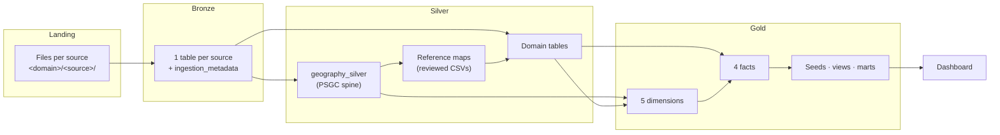

# Data lineage map

This page shows how each source flows from landing to the dashboard: source → bronze → silver → gold → mart. Use it to answer "which outputs change if this source changes?" and "where did this number come from?".

Owner: LUNASaan Documentation Team
Last updated: 2026-10-21

The table-level map below is the design. **The exact lineage of the latest run is recorded in `public_health.quality.build_log` and `build_inputs` (defined in the [lineage and quality contract](../04-pipeline/quality/lineage-and-quality-contract.md), v1.3).** Use the queries in [section 5](#5-trace-lineage-from-the-quality-tables) when you need certainty. These tables are not yet implemented in this workspace; see the build-status note at the start of [section 5](#5-trace-lineage-from-the-quality-tables).

---

## 1. Layer flow



Rules that hold everywhere:

- Gold never reads bronze. Silver never reads landing.
- Every domain maps its areas to `geography_silver` through reference maps. No build matches by name.
- Gold dimensions join to facts by surrogate keys. `dim_facility` joins to `dim_geography` only.


## 2. Source → bronze → silver

| Domain | Source(s) | Bronze table | Silver table |
|---|---|---|---|
| Geography | `psgc` | PSGC bronze table (`psgc.bronze_table` in YAML) | `geography_silver` |
| Population | `psgc_population` (payload in PSGC rows) | same PSGC table | `population_silver` |
| Geography | `hdx_phl_admin` | `admin_boundaries_bronze` (not yet built) | `admin_boundaries_silver` (not yet built) |
| Diseases | `doh_foi_dengue`, `upnoah`, `hdx_dengue`, PSA deaths entries, `doh_fhsis` (TB, morbidity), `ihme_gbd` | `diseases_*_bronze` (one per source) | `diseases_metric_silver` |
| Diseases | `psa_deaths_region_annual` (age groups) | `diseases_psa_deaths_region_annual_bronze` | `diseases_deaths_age_silver` |
| Diseases | `davao_hospital_pneumonia` | `diseases_davao_hospital_pneumonia_bronze` | `diseases_hospital_encounters_silver` |
| Diseases | (from `diseases_metric_silver`) | — | `diseases_source_coverage_silver` |
| Diseases | `doh_fhsis_tb_tpt`, `doh_fhsis_tb_treatment_success` | FHSIS TB bronze | `diseases_tb_programme_silver` |
| Diseases | `philhealth_foi_claims_hospital` (+ facilities registry) | claims bronze | `diseases_hospital_claims_silver` |
| Diseases | reference CSVs | — | `diseases_directory_silver`, `diseases_cause_aggregation` (and area/cause maps) |
| Diseases | `doh_foi_tb_region2`, `philhealth_foi_tb_claims` | their bronze tables | none (bronze only) |
| Facilities | `doh_nhfr`, `doh_hfsrb_*` | `facilities_nhfr_bronze`, `facilities_hfsrb_*_bronze` | `facilities_id_map_silver`, `facilities_registry_silver` |
| Facilities | PSA hospital/bed/BHS tables, `doh_fhsis_demographic` (BGY & BHS) | `facilities_psa_*_bronze`, `facilities_fhsis_primary_care_bronze` | `facilities_metric_silver` |
| Facilities | `doh_foi_hospital_beds` | `facilities_bed_occupancy_bronze` | `facilities_bed_occupancy_silver` |
| Facilities | `hdx_healthsites` (+ `admin_boundaries_silver`) | `facilities_hdx_healthsites_bronze` | `facilities_area_boundary` (not yet built), `facilities_osm_point_silver` (not yet built) |
| Workforce | `doh_fhsis_demographic`, `psa_gov_practitioners` | `workforce_fhsis_health_workers_bronze`, `workforce_psa_gov_practitioners_bronze` | `workforce_headcount_silver` |
| Workforce | `doh_fhsis_demographic` | same | `workforce_area_denominator_silver` |
| Workforce | `psmo_oncologists` | `workforce_psmo_oncologists_bronze` | `workforce_specialist_silver` |
| Socioeconomic | `psa_poverty` | `socioeconomic_psa_poverty_bronze` | `socioeconomic_poverty_silver` |
| Socioeconomic | `psa_health_expenditure_share_national_annual` | `socioeconomic_psa_health_expenditure_share_bronze` | `socioeconomic_health_expenditure_share_silver` |
| Socioeconomic | `psa_health_expenditure_per_capita_national_annual` | `socioeconomic_psa_health_expenditure_per_capita_bronze` | `socioeconomic_health_expenditure_per_capita_silver` |
| Socioeconomic | `psa_child_mortality` | `socioeconomic_psa_child_mortality_bronze` | `socioeconomic_child_mortality_silver` (not used in gold) |
| Socioeconomic | `psa_psgc` | `socioeconomic_psa_psgc_bronze` | none (geography owns PSGC) |

The exact source list of `diseases_metric_silver` is in `build_inputs` (query 5.1).

## 3. Silver → gold

| Gold object | Reads (silver) |
|---|---|
| `dim_geography` | `geography_silver`, `admin_boundaries_silver` |
| `dim_date` | Every silver table with a period |
| `dim_data_source` | Reviewed list copied from the YAML files |
| `dim_facility` | `facilities_registry_silver` (+ `dim_geography`) |
| `dim_disease` | `diseases_directory_silver`, `diseases_cause_aggregation` |
| `fact_facility_capacity` | `facilities_registry_silver`, `facilities_metric_silver`, `facilities_bed_occupancy_silver` |
| `fact_disease_metric` | `diseases_metric_silver`, `diseases_source_coverage_silver`, `diseases_deaths_age_silver`, `diseases_tb_programme_silver`, `diseases_hospital_claims_silver` |
| `fact_workforce_capacity` | `workforce_headcount_silver` |
| `fact_area_indicator` | `population_silver`, `workforce_area_denominator_silver`, `socioeconomic_poverty_silver`, both health expenditure tables |
| `ref_osm_healthsite_point` | `facilities_osm_point_silver` |

## 4. Gold → marts → dashboard

| Mart / view | Reads | Dashboard page |
|---|---|---|
| `v_facility_capacity_totals`, `v_disease_metric_totals`, `v_workforce_preferred`, `v_area_indicator_latest` | the 4 facts (+ `source_priority`) | Any page (default totals) |
| `mart_locality_service_presence` | `fact_facility_capacity`, `fact_area_indicator`, `dim_geography` | Access to early care |
| `mart_base_planning_unit` | `mart_locality_service_presence` | (helper) |
| `mart_area_service_profile` | facility, workforce and indicator facts; `area_coverage_map` | Gaps and equity |
| `mart_area_burden_indicator` | `fact_disease_metric`; `source_priority`; `area_coverage_map` | Need |
| `mart_area_evidence` | marts 16, 17 | About the data |
| `mart_area_priority` | marts 16, 17; `priority_weight_params` | Gaps and equity |
| `fact_area_access` | mart 14; `ref_osm_healthsite_point` | Access to early care |
| `mart_tb_case_study` | mart 14; disease and workforce facts | Case studies |
| `mart_kidney_case_study` | mart 14; `huc_province_crosswalk`; disease and facility facts | Case studies |
| `mart_dengue_peak_capacity` | disease, facility and indicator facts; `area_coverage_map` | Preparedness |
| `mart_evidence_readiness` | `quality.v_latest_build`, `build_inputs`, `v_table_health` | About the data |

## 5. Trace lineage from the quality tables

The `build_log`, `build_inputs`, and `v_latest_build` tables and views are defined in the [lineage and quality contract](../04-pipeline/quality/lineage-and-quality-contract.md) (v1.3) but are not yet implemented in this workspace. The queries below will work once the gold pass creates them. Until then, trace lineage manually from the silver row's `_source_key`, `_source_file`, and `_source_row_num` columns back to bronze.

### 5.1 What did the latest build of a table read?

```sql
SELECT l.target_table, l.build_id, l.finished_at,
       i.input_kind, i.input_table, i.input_table_version,
       i.source_key, i.source_file, i.source_sheet,
       i.load_batch_id, i.content_checksum, i.input_rows
FROM public_health.quality.v_latest_build AS l
JOIN public_health.quality.build_inputs AS i
  ON i.build_id = l.build_id
WHERE l.target_table = 'public_health.silver.diseases_metric_silver'
ORDER BY i.input_kind, i.source_key, i.source_file;
```

### 5.2 Which silver tables does a source feed?

```sql
SELECT DISTINCT i.source_key, l.layer, l.target_table
FROM public_health.quality.build_inputs AS i
JOIN public_health.quality.v_latest_build AS l
  ON l.build_id = i.build_id
WHERE i.input_kind = 'bronze_source'
  AND i.source_key = 'doh_foi_dengue'
ORDER BY l.layer, l.target_table;
```

### 5.3 Which gold tables read a silver table?

```sql
SELECT DISTINCT l.target_table AS gold_table
FROM public_health.quality.build_inputs AS i
JOIN public_health.quality.v_latest_build AS l
  ON l.build_id = i.build_id
WHERE l.layer = 'gold'
  AND i.input_table = 'public_health.silver.diseases_metric_silver';
```

Gold marts are views, so they have no `build_log` row. Use section 4 for mart lineage.

Columns follow the [lineage and quality contract](../04-pipeline/quality/lineage-and-quality-contract.md) (v1.3), section 5.0.1. `target_table` and `input_table` hold full three-part names.

### 5.4 Trace one dashboard number to a source cell

1. Find the mart row and its fact rows (keys in the mart).
2. Read `_gold_build_id` on the fact row; look it up in `build_log` and `build_inputs` for the silver version it read.
3. Find the silver row by its natural key at that version.
4. Read its lineage: `_source_key`, `_source_file`, `_source_sheet`, `_source_row_num`, and `_metric_source_columns` for unpivoted values.
5. Open the bronze row with the same file, sheet and row number. The value is the original text.

The full eight-step walk is in the [lineage and quality contract](../04-pipeline/quality/lineage-and-quality-contract.md), Appendix A.7.

## 6. History of updates

| Date | Change |
|---|---|
| 2026-10-19 | Page written from the silver overview, gold README and job definition |
| 2026-10-21 | History brought up to date: the workspace build-status caveats in the intro and section 5 (lineage tables not yet implemented here; gold not built in this workspace) were added 2026-10-20 but not recorded; intro pointer corrected to the section-5 note, where the note actually lives — no note was added at the end of section 1 |
