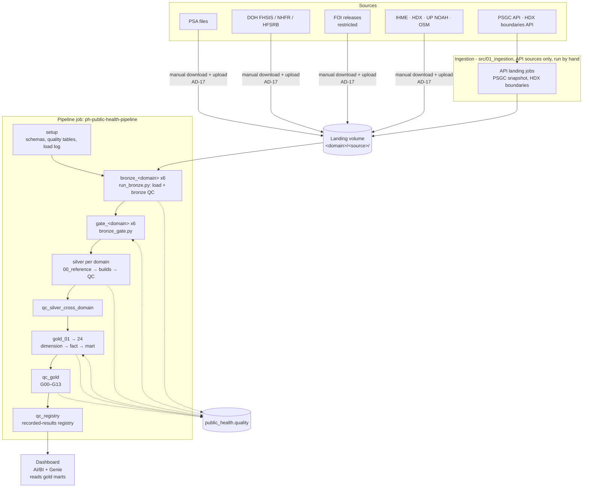
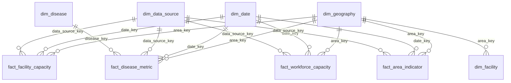

# Architecture overview

Owner: LUNASaan Documentation Team
Last updated: 2026-10-20

This page shows how the platform works. It covers the layers, where data lives, how the job runs and where checks happen. Read it before any layer page.

Status date: 2026-10-20. Platform facts (versions, libraries, what to change outside Databricks) live in [reproducibility](../07-operations/reproducibility.md).

## At a glance

| Component | Technology |
|---|---|
| Compute | Serverless Spark (Python tasks) + serverless SQL warehouse |
| Storage | Delta Lake on Unity Catalog (`public_health` catalog) |
| Orchestration | Databricks Jobs via Declarative Automation Bundles (`databricks.yml`) |
| CI/CD | GitHub Actions (lint, test, SQL lint, secret scan, bundle deploy) |
| Version control | Git (GitHub, `dev` → `main` branching) |
| Dashboard | Databricks AI/BI (Lakeview) with Genie |
| Landing volume | Unity Catalog volume (`/Volumes/workspace/default/ftw-b12-de/groups/g5_landing`) |

---

## 1. One-line summary

The platform is a medallion lakehouse on Databricks.

- Source files land as they are.
- **Bronze** copies them as text.
- **Silver** cleans them and codes them to one geography.
- **Gold** models them as a star schema with marts.
- The **quality** schema records every check, build and input.

One job runs it all. It stops on the first failure.

## 2. Architecture diagram

## 3. Layers

| Layer | Schema | Unit of work | Write pattern | Owns |
|---|---|---|---|---|
| Landing | Volume folder | One file | Never edited; new release = new file | Original files |
| Bronze | `public_health.bronze` | One file or sheet | File sources: `replaceWhere` per file. PSGC: insert-only `MERGE`. HDX: append per version | Faithful copy as text + lineage |
| Silver | `public_health.silver` | One table build | Write-audit-publish full rebuild. Geography and boundaries use `MERGE`. The facility registry carries its state forward | Types, PSGC codes, row-level lineage, set-aside rows |
| Gold | `public_health.gold` | One table build | Write-audit-publish; marts and default views are views | Model, source selection, rates, marts |
| Quality | `public_health.quality` | One check, run or build | Append-only | Every result, build, input and disposition |

What each layer must **not** do:

| Layer | Never |
|---|---|
| Bronze | Cast, clean, match areas or pick a source |
| Silver | Compute rates, pick a preferred source, aggregate across causes, levels or sources |
| Gold | Read bronze, re-parse text, re-derive load ids |

## 4. Domains

| Domain | Silver tables | Gold facts |
|---|---|---|
| Geography | `geography_silver` (PSGC spine), `admin_boundaries_silver` | `dim_geography` |
| Population | `population_silver` | `fact_area_indicator` |
| Diseases | metric, deaths by age, hospital encounters, source coverage, TB programme, hospital claims + reference tables | `fact_disease_metric`, `dim_disease` |
| Facilities | id map, registry, metric, bed occupancy, area boundary, OSM points | `fact_facility_capacity`, `dim_facility`, `ref_osm_healthsite_point` |
| Workforce | headcount, area denominator, specialist | `fact_workforce_capacity`, `fact_area_indicator` |
| Socioeconomic | poverty, health expenditure (2), child mortality | `fact_area_indicator` |

**Geography is the spine.** `geography_silver` is the only table that may define a PSGC code (D-30). Every other domain maps its labels to it through reviewed reference maps. A gate checks each build against it.

## 5. Gold model

- 5 dimensions, 4 facts (D-36). Breakdowns such as ownership, hospital level, age, sex and profession are columns, not extra tables.
- `dim_facility` joins to `dim_geography` only. Joining it to a fact would repeat area totals (D-39).
- Seeds (`source_priority`, `priority_weight_params`), a crosswalk, a coverage map, 4 default views and the marts sit on top.

Detail: `src/04_gold/README.md` and [gold docs](../04-pipeline/gold/README.md).

## 6. Orchestration

One Databricks job, `ph-public-health-pipeline`, defined in `resources/ph_public_health_job.yml` and deployed with Asset Bundles. A second job, `ph-public-health-setup` (`resources/ph_public_health_setup_job.yml`), creates the schemas, the quality tables and the load log. It runs `src/00_setup/schema_setup.sql` and `src/00_setup/quality_setup.sql`. The pipeline runs it as its first task.

| Stage | Tasks | Waits for |
|---|---|---|
| 0. Setup | `setup` runs the setup job (creates what is missing) | — |
| 1. Bronze | `bronze_<domain>` × 6: `run_bronze.py --domains <domain>` (load + bronze QC, QC re-queue) | setup |
| 2. Preload gate | `gate_<domain>` × 6: `bronze_gate.py` | that domain's bronze |
| 3. Silver | Geography first; then facilities, diseases, workforce, socioeconomic: `00_reference` → builds → domain QC | the domain gate and geography silver QC |
| 4. Cross-domain QC | `qc_silver_cross_domain` | every silver QC task |
| 5. Gold | `gold_01` → dimensions → facts → marts (task key = file name, files in `src/04_gold/{dimension,fact,mart}`); the setup job creates the `gold` schema | cross-domain QC |
| 6. Gold QC | `qc_gold` (G00–G13), then `qc_registry` validates the registry against recorded results | `gold_24`, then `qc_gold` |

**Dependency rule:** a task waits for the tables it reads *and* for the QC of those tables. A FAIL stops everything downstream.

| Job setting | Value |
|---|---|
| Concurrency | `max_concurrent_runs: 1` (PSGC and HDX loaders allow one writer) |
| Compute | Serverless. Python tasks on environment `default` (pyyaml, openpyxl); `geo` adds shapely<2.1 and numpy<2 for the OSM point-in-polygon step (shapely 2.1 requires numpy 2, which breaks pandas in other tasks). SQL tasks on a SQL warehouse |
| Schedule | No active schedule. The proposed Monday 06:00 Asia/Manila schedule is commented out in the job YAML, so runs stay manual (D-59). |
| Not in the job | You run these by hand: `src/01_ingestion` (PSGC and HDX API landing), the manual uploads for the other four domains (AD-17), and `builders/` (reference CSV generators) |

## 7. Serving

The dashboard is a Databricks AI/BI (Lakeview) dashboard with Genie, deployed by the bundle from `dashboard/*.lvdash.json` (`resources/ph_public_health_dashboard.yml`). It reads **gold marts and default views only**, never silver or the raw facts.

| Dashboard page (D-29) | Gold objects |
|---|---|
| Need | `mart_area_burden_indicator`; `v_disease_metric_totals` for trends |
| Access to early care | `mart_locality_service_presence`, `fact_area_access` |
| Gaps and equity | `mart_area_service_profile`, `mart_area_priority`, `mart_area_evidence` |
| Case studies | `mart_tb_case_study`, `mart_kidney_case_study` |
| Preparedness | `mart_dengue_peak_capacity` |
| About the data | `mart_evidence_readiness`, `mart_area_evidence`, `dim_data_source` (sources, sharing, notes) |

| Item | Value |
|---|---|
| Viewer permissions | `embed_credentials: false`: viewers query with their own permissions, so table grants decide what each viewer sees |
| Refresh | Marts are views, so the dashboard shows the latest gold build on its next query. The job YAML holds a `dashboard_refresh` task after `qc_gold`, commented out. If enabled, it runs only when gold QC passes |
| Restricted data | Aggregates only, cells under 3 suppressed (D-47); IHME and OpenStreetMap attribution lines on their charts |
| Wording | "Recorded", "lowest 20% of planning units", "straight-line distance" ([gold usage rules](../04-pipeline/gold/gold-usage-rules.md)) |

The mapping above follows the dashboard story in D-29; check it against the final `.lvdash.json` before submission.

## 8. Quality architecture

Three kinds of check, one record:

| Kind | Where | Stops | Writes |
|---|---|---|---|
| Loader checks | Bronze, around each write | That source's load | `ingestion_metadata` status |
| Build gates | Silver and gold, on the candidate before publish | That build. The published table stays as it was | `build_log` (`failed`) |
| QC scripts | Every layer, on stored tables, through `DQRun` | The job, before the next layer | `qc_results`, `run_log`, `table_stats`, `profile`, `quarantine` |

Plus two job-level gates:

- **Preload gate** (`bronze_gate.py`): stops a domain's silver when a bronze source is FAIL, CRASHED, STALE or NOT_CHECKED (D-51).
- **Silver-QC gate in gold**: every gold build refuses a silver input whose latest QC has a FAIL.

Detail: [quality control framework](../04-pipeline/quality/quality-control-framework.md).

## 9. Lineage

| Level | How |
|---|---|
| Bronze row | `_source_key`, `_source_file`, `_source_sheet`, `_source_row_num`, `_as_of_date`, `_ingested_at` |
| Silver row | `_silver_build_id` + the five source columns above (`_metric_source_columns` where unpivoted) |
| Silver build | `build_log` (one row) + `build_inputs` (one row per file, sheet or reference read, with load id and checksum) |
| Rows not loaded | `row_disposition` with a reason |
| Gold row | `_gold_build_id`; inputs recorded once per build |

A dashboard number traces back to a source cell. See [data lineage map](../02-data/data-lineage-map.md).

## 10. Reliability properties

| Property | How |
|---|---|
| Idempotent | Bronze replaces a file's rows and never appends them twice. Builds publish only after their gates pass. `MERGE` runs on stable keys. Surrogate keys are hashes of natural keys |
| Incremental | Bronze loads only new or changed files. Silver and gold rebuild in full on purpose (D-57); cost control is by skipping unchanged work, see the [silver rebuild strategy](../04-pipeline/silver/rebuild-strategy.md) |
| Gated | Loader checks, build gates, QC scripts, preload gate, silver-QC gate in gold |
| Recoverable | A failed build leaves the published table as it was. Delta history keeps old versions. Every failure has a rerun path |
| Auditable | Lineage columns, build tables, QC results linked to the job run id |

## 11. Environments

| Item | Value |
|---|---|
| Workspace | Personal Databricks workspace (the FTW org workspace could not reach the external volume) |
| Catalog | `public_health` |
| Schemas | `bronze`, `silver`, `gold`, `quality`; `test_gold`, `test_gold2` (testing, to archive once the dashboard reads `gold`) |
| Landing | Unity Catalog Volume (`/Volumes/workspace/default/ftw-b12-de/groups/g5_landing`) |
| Deploy target | `dev` (Asset Bundles). `databricks.yml` also defines a `prod` target whose service principal is not set yet; it is not used for the capstone |

## 12. CI/CD

CI runs on every push and PR to `dev` and `main`:

| Check | Tool |
|---|---|
| Python lint and format | ruff (via pre-commit) |
| Unit tests | pytest with coverage |
| SQL lint | sqlfluff |
| Secret scan | gitleaks |
| Repo hygiene | Large files over 5 MB, notebook outputs |

CD deploys the bundle after CI passes: `dev` branch → dev target, `main` → prod target. The prod target requires a manual approval gate (GitHub Environment reviewer). See [CI/CD and testing](../07-operations/ci-cd-and-testing.md).

## See also

- [Architecture decisions](architecture-decisions.md) — why each choice was made
- [Project conventions](project-conventions.md) — naming, coding and Git rules
- [Decision log](../08-governance/decision-log.md) — every dated decision and open question
- [Data sources](../02-data/data-sources.md) — source inventory and coverage
- [Known issues and backlog](../08-governance/known-issues-and-backlog.md) — what is open after the capstone
- [Runbook](../07-operations/runbook.md) — how to run and troubleshoot the pipeline
- [Bronze layer](../04-pipeline/bronze/README.md) · [Silver layer](../04-pipeline/silver/README.md) · [Gold layer](../04-pipeline/gold/README.md) — layer-specific details
- [Quality control framework](../04-pipeline/quality/quality-control-framework.md) — check rules, severities and gates

## 13. History of updates

| Date | Change |
|---|---|
| 2026-10-06 | Config-driven bronze for all domains |
| 2026-10-07 | `public_health.quality` schema and `DQRun` |
| 2026-10-09 | Lineage contract reduced columns; build tables required |
| 2026-10-14 | Gold data model v2 (5 dims, 4 facts); incremental bronze |
| 2026-10-16 / 17 | Full end-to-end runs 1 and 2 |
| 2026-10-18 | Gold promoted to `public_health.gold`; `gold_qc.py` |
| 2026-10-19 | Preload gate, QC re-queue, geography inside `run_bronze.py`. Page written |
| 2026-10-20 | Reliability row updated. Silver uses a full rebuild (D-57). Gold starts at `gold_01`. Runs stay manual (D-59) |
| 2026-10-20 | Diagram shows the manual download and upload (AD-17, D-63). Setup job named. Serving section added. `prod` target noted as unused. Rewritten in short, active sentences |
| 2026-10-20 | Owner and last-updated metadata added. Tech stack table and CI/CD section added. Gold QC check range corrected to G00–G13. Serverless environment detail and setup SQL file references added. Landing volume path made explicit |
| 2026-10-20 | Broken quality README link fixed to quality-control-framework.md. See also section added |
