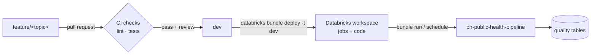

# CI/CD setup

How code moves from a branch to a running Databricks job: the checks on every pull request, how the job is deployed, and what is not automated yet.

Status date: 2026-10-20. Items marked **confirm** need a check against `.github/workflows/` and `databricks.yml` in the repository.

---

## 1. Flow



## 2. Continuous integration (GitHub Actions)

Runs on every pull request.

| Check | Tool | Covers | Notes |
|---|---|---|---|
| SQL lint | `sqlfluff` | `src/**/*.sql` | Diseases silver `01`–`03` are skipped: over the sqlfluff size limit |
| Python tests | `pytest` | Test folder (**confirm** path) | Coverage is thin. Local stub tests for `run_bronze.py` and `bronze_gate.py` (2026-10-19) are the starting point (backlog 21) |
| Reviewer assignment | GitHub Action | Every pull request | Auto-assigns reviewers |

**Confirm:** workflow file names, the Python version used in CI, and whether YAML (`config/*.yaml`) is linted.

### Run the checks locally

```bash
pip install sqlfluff pytest pyyaml
sqlfluff lint src/ --dialect sparksql
pytest
```

Use the repository's `.sqlfluff` config if it exists. It sets the dialect and the excluded files.

## 3. Continuous deployment (Databricks Asset Bundles)

| Item | Value |
|---|---|
| Bundle file | `databricks.yml` (on `dev` since 2026-10-11) |
| Jobs | `resources/ph_public_health_job.yml` (pipeline), `ph_public_health_setup_job.yml` (setup) |
| Target | `dev` |
| Workspace | Personal Databricks workspace (the FTW org workspace could not reach the external volume) |
| Variables | `warehouse_id` for SQL tasks |
| Synced | `src/`, `config/`, `resources/`. **Not synced:** `src/01_ingestion` |
| Schedule | Defined and paused: Monday 06:00 Asia/Manila. Runs stay manual (D-59) |

### Deploy and run

```bash
databricks auth login --host <workspace-url>
databricks bundle validate -t dev
databricks bundle deploy -t dev
databricks bundle run ph_public_health_pipeline -t dev
```

**Confirm:** whether deploy runs from GitHub Actions on merge to `dev` or by hand. If it runs from Actions, the workflow needs `DATABRICKS_HOST` and a token or service principal as repository secrets. Never commit them.

### Compute environments

| Environment | Used by | Dependencies (pinned) |
|---|---|---|
| `default` | Every Python task except the OSM step | `pyyaml==6.0.2`, `openpyxl==3.1.5` |
| `geo` | `facilities_silver_04a_osm_locate.py` only | `numpy<2`, `pyyaml==6.0.2`, `openpyxl==3.1.5`, `shapely<2.1` |
| SQL warehouse | Every `.sql` task | — |

`shapely` 2.1 needs numpy 2, which broke pandas imports on the base image. Keep the pins until the base image moves to numpy 2.

## 4. What the job guarantees after deploy

| Guarantee | How |
|---|---|
| One run at a time | `max_concurrent_runs: 1` |
| Downstream stops on failure | Each task waits for its inputs and their QC |
| Runs are traceable | `{{job.run_id}}` passed to `run_bronze.py`, the gold QC and several silver QC tasks; stored in `run_log` |
| Reruns are safe | Incremental bronze, write-audit-publish builds, preload gate |

## 5. Release checklist

Before merging a change that touches the pipeline:

1. CI passes (lint, tests).
2. Docs updated in the same pull request (layer README, overview, decision log if a decision changed).
3. For bronze: `run_bronze.py --plan true` shows only the expected loads.
4. For silver or gold: the build ran once on Databricks; gates returned 0; QC has no FAIL.
5. After deploy: one full job run; record date, duration and result in the layer README history and in `docs/06-evidence/`.
6. For idempotency evidence: run the job three times on the same inputs; every gold G12 row should PASS on runs 2 and 3.

## 6. Gaps and next steps

| Gap | Next step | Backlog |
|---|---|---|
| CI checks failing on `dev` | Fix after submission | — |
| Diseases silver `01`–`03` not linted | Split `01` into smaller files | Silver recommendation 10 |
| Few automated tests | pytest for the bronze loader, `run_bronze.py`, `bronze_gate.py` | 21 |
| No check that repo and Volume reference CSVs match | CI step comparing checksums | 16 |
| Deploy of the 2026-10-19 job not confirmed | Deploy and run; record evidence | 10 |
| No dashboard refresh task | Add `dashboard_refresh` after `qc_gold` if needed | 10 |
| `check_registry` not seeded | Seed, then switch QC to `strict_registry=True`; a CI check could fail on unknown codes | 7 |

## 7. History of updates

| Date | Change |
|---|---|
| 2026-09 | GitHub repository and Actions plan: PR checks, auto-assign reviewers, pytest |
| 2026-10-11 | `databricks.yml` added on `dev` |
| 2026-10-15 | Two pinned serverless environments (`default`, `geo`) |
| 2026-10-19 | Job updated: preload gate tasks, geography inside `run_bronze.py`, gold paths. Page written |
| 2026-10-20 | Runs stay manual (D-59); three evidence runs; failing checks on `dev` listed as a gap |