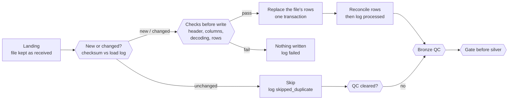

# Bronze layer

Bronze is the platform's filing cabinet. Every source file is copied into the lakehouse exactly as it arrived: DOH FOI releases, PSA tables, FHSIS workbooks, PhilHealth claims, hospital lists, OpenStreetMap points, the PSGC code list and the HDX boundaries. Nothing is corrected, converted or combined. If a spreadsheet says "1,234" as text, bronze keeps "1,234" as text.

What bronze adds is a label on every row: which source, file, sheet and row it came from, when it was loaded, and which version of the source it is. That gives the platform two properties:

- **Trust.** Any number on the dashboard can be traced back to the file and row it came from.
- **Safe reruns.** Unchanged files are skipped, changed files are reloaded, and silver never builds on a load that failed or skipped its checks.

Cleaning, matching and calculations happen in silver and gold, where a mistake can be fixed without losing the original.

This page is the overview. The full reference (folder layout, YAML entries, load sequence, every check code, options, recovery table and limits) is [`src/02_bronze/README.md`](../../../src/02_bronze/README.md).

Status date: 2026-10-19 (bronze closed: code, QC and docs done).

## Pages in this folder

| Page | What it covers |
|---|---|
| [geography.md](geography.md) | The PSGC API snapshot and the HDX administrative boundaries |
| [population.md](population.md) | Census population carried inside the PSGC payload |
| [diseases.md](diseases.md) | Dengue, TB, deaths, morbidity, hospital claims and encounters, IHME estimates |
| [facilities.md](facilities.md) | Facility registries, PSA facility tables, bed occupancy, OSM health sites |
| [workforce.md](workforce.md) | FHSIS health workers, PSA government practitioners, PSMO oncologists |
| [socioeconomic.md](socioeconomic.md) | Poverty, health expenditure, child mortality |
| [bronze-quality-checks.md](bronze-quality-checks.md) | Every bronze check: loader checks, QC codes, the gate, what to do on a failure |

## How a load works

1. **Land.** A file goes to `<domain>/<source>/` in the landing Volume and is never edited. A newer release is a new file in the same folder.
2. **Describe.** Each dataset is one entry in `config/sources_<domain>.yaml`: where it is, how to read it, which table it goes to, and the expected row counts and control values for QC. Adding a dataset means adding an entry, not code.
3. **Compare.** The loader compares each file's checksum and `as_of_date` with its last `processed` row in `bronze.ingestion_metadata`. Unchanged files are skipped and keep their rows and load time.
4. **Check before writing.** Header text at the expected positions, required columns, strict decoding, at least one data row. If any file of a source fails, nothing is written for that source.
5. **Write.** Each file's rows are replaced in one transaction (Delta `replaceWhere` on source key and file), so a rerun never doubles rows.
6. **Reconcile and log.** Rows in the table must equal rows read; then one `ingestion_metadata` row per file or sheet.
7. **QC.** Each loaded source gets its bronze QC. An unchanged source whose last QC did not clear is checked again (re-queue).
8. **Gate.** Before a domain's first silver task, `bronze_gate.py` stops silver if any source it reads is not cleared.

`run_bronze.py` runs the loader and QC for all six domains in one command, geography first because every silver domain reads it.

## Three kinds of loader

| | File loaders (diseases, facilities, workforce, socioeconomic) | PSGC (`geography_bronze.py`) | HDX boundaries (`admin_boundaries_bronze.py`) |
|---|---|---|---|
| Reads | Files listed in the domain YAML | The newest complete PSGC API snapshot | The latest HDX ingestion run's handoff |
| Writes | One table per source | One PSGC snapshot table | `admin_boundaries_bronze` |
| Rerun on unchanged input | File skipped | No write (same snapshot) | No write (same source version) |
| Load log | One row per file or sheet | One row per run | None (limit L4) |

The four file loaders are the same code; only the domain name and config differ. The team moved every domain from one script per dataset to this YAML pattern on 2026-10-06.

## Row shape

One bronze row is one data row of one source file or sheet. There is no business key, and **every data column is STRING**.

| Lineage column | Meaning |
|---|---|
| `_source_key` | The YAML entry |
| `_source_file` | Path under the landing root; also the unit replaced on a reload |
| `_source_sheet` | Excel sheet; null for CSV |
| `_source_row_num` | Row number in the file or sheet |
| `_as_of_date` | Release or download date from the YAML, not the load time |
| `_ingested_at` | Load time (UTC) |
| `_rescued_data` | Cells beyond the last named column |

Load id and file checksum are not on the rows: silver reads them from `ingestion_metadata` for its lineage (decision 2026-10-08). PSGC keeps each record as JSON plus the nested population JSON; HDX keeps each feature, its properties and its geometry as JSON.

Extraction rules: empty cells become null, Excel dates become ISO text, whole-number floats lose `.0`, formulas are read as their saved values, fully empty rows are skipped and counted. Footer and note lines are loaded; silver drops them.

## Quality

Bronze QC checks that each load is **complete and faithful to its source**. Business rules are silver's job. Every script writes through `dq_utils.DQRun` into `public_health.quality.qc_results`.

| Severity | Meaning |
|---|---|
| **FAIL** | The load is wrong or can't be traced: missing file, wrong row count, double load, broken lineage, a number that disagrees with a verified control. Stops the job before silver |
| **WARN** | The load is faithful, but the source has something to look at: blank rows, repeats, text in a number column, a total that doesn't add up. Rows are kept |

| Script | Codes | Checks |
|---|---|---|
| `<domain>_bronze_qc.py` (4 file domains, same code) | B00–B15 | Files loaded, rows per file vs expected and vs the load log, required columns, lineage, no double load, empty and repeated rows, numeric columns, control totals, row sums, all columns STRING |
| `geography_bronze_qc.py` | GB00–GB13 | Landing batch complete, row and code counts, codes unique, stored JSON = landed JSON, lineage, load log |
| `admin_boundaries_bronze_qc.py` | HB00–HB14 | Counts per admin level, fingerprints, p-codes and names, geometry types, parent references |
| `psgc_population_bronze_qc.py` | B01–B16 subset | The population JSON parses; values readable as numbers |

Every check in detail: [bronze quality checks](bronze-quality-checks.md).

YAML overrides (`qc.skip_checks`, `qc.severity`) are validated, B00 can't be skipped, and every override is written into `qc_results`, so a switched-off check stays visible.

**Expected WARNs** (2026-10-19): B08 `philhealth_foi_claims_hospital` (repeat rows in the source; silver sums them), B08 `doh_fhsis_demographic` in workforce (blank-area rows in the 2019 workbook; silver drops them), B10 `psgc_population` (population text with separators or notes; silver parses it).

### The gate before silver

`bronze_gate.py` runs as one job task per domain. It reads `public_health.quality`, writes nothing, and stops that domain's silver when a source it reads is in one of these states:

| State | Meaning |
|---|---|
| FAIL | The latest QC run has a FAIL |
| CRASHED | A QC run of the domain crashed at or after the source's latest result |
| STALE | The source was reloaded after its latest QC |
| NOT_CHECKED | No QC result at all |

PASS and WARN pass. The gate checks the domain's YAML sources and every bronze source its latest silver build read, so a source switched off in the YAML but still read by silver is caught. A source shared by two domains (`doh_fhsis_demographic`) is checked once per domain.

## Reliability

| Property | How bronze provides it |
|---|---|
| Idempotent | One file or sheet is replaced in one transaction; PSGC uses an insert-only MERGE; HDX skips a complete version. Running twice never doubles rows |
| Incremental | Only new, changed, re-dated or forced files load |
| Gated | Checks before the write, after the write and on the stored table; a QC FAIL stops the run, and the gate stops silver |
| Recoverable | Every failure has a rerun path; landing files are never edited; Delta history keeps earlier versions |
| Auditable | One log row per file per run, one QC row per check, QC runs linked to the job run id |

Rerun means `run_bronze.py` again with no flags. A changed parsing setting is not detected; use `--force_keys <source>` and rerun that domain's silver. The recovery table for every failure case is section 8 of the reference.

## Latest recorded run

On Databricks, 2026-10-19:

| Step | Result |
|---|---|
| `bronze_gate.py`, all domains | 41 sources: 39 PASS, 2 WARN (the B08 WARNs above), 0 blocking |
| `run_bronze.py`, all 6 domains | 46 sources unchanged, 0 loaded, 0 failed, 0 QC re-queued |

The first full job run with the six `gate_<domain>` tasks before silver goes to [evidence](../../06-evidence/README.md) and section 11 of the reference.

## Restricted sources

`sharing` is set per YAML entry: `open`, `public` or `restricted`. Restricted covers the FOI releases, the patient-level Davao hospital extract, the bed occupancy file and IHME GBD (licence). Under D-47 they are for academic use and aggregate reporting only:

- the files sit under `<domain>/restricted/` and are never committed to GitHub;
- their values are never copied into docs;
- bronze QC writes no column profile for them;
- gold publishes them as aggregates only, with cells from fewer than 3 records or hospitals suppressed.

Unity Catalog grants are not applied yet (limit L6). See [data governance](../../08-governance/data-governance.md).

## Scope

Bronze does: copy files as received, add row-level lineage, skip unchanged files, check each load before and after the write, log every load, gate silver.

Bronze does not: convert types, fix values, match areas, remove duplicates or apply business rules. Those are silver.

## Limitations

| Area | Limitation |
|---|---|
| Code | The loader is copied into four domain files and the QC into four QC files; they are kept in sync by hand |
| Change detection | Parsing-setting and loader-code changes are not detected (`--force_keys`); no schema or row-count drift checks yet |
| Row counts | B03 is only WARN for files without `qc.expected_rows`, so a plausible wrong count passes |
| HDX | No `ingestion_metadata` row, so the gate can't detect STALE for the boundaries |
| Lineage | Column names differ between the file loaders, PSGC and HDX |
| Contracts | Facilities entries 1–13 have no `header_check`; `_as_of_date` mixes release and download dates |
| Geography | PSGC is ingested twice (API snapshot and the socioeconomic datafile); the platform stands on the Q2_2024 API snapshot |
| Access | `sharing: restricted` is declared, not enforced by grants |

The full list (L1–L15) is section 12 of the reference. Open items and recommendations: [known issues and backlog](../../08-governance/known-issues-and-backlog.md). Decisions: [decision log](../../08-governance/decision-log.md).
