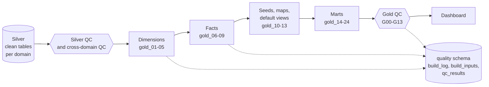

# Gold

Owner: LUNASaan Documentation Team
Last updated: 2026-10-21

Gold turns the cleaned silver tables into answers. It arranges the data around five things a policymaker thinks in: **where** (geography), **when** (date), **which disease**, **which facility** and **which source said so**. Four fact tables hold the numbers:

- capacity: facilities and beds in an area;
- disease: cases, deaths and claims;
- workforce: health workers;
- area indicators: population, poverty and health spending. The **marts** sit on top of the model. Each mart is a view that answers one group of business questions for the dashboard.

Gold computes rates for the first time. Three rules apply:

- Every rate uses one named population figure.
- Every number keeps its source.
- Every comparison first checks that the areas cover the same ground.

When a fair comparison is not possible, the mart says why. It never shows a wrong number or a zero.

Status date: 2026-10-20. Schema: `public_health.gold`. Reference README (run order, every file, recovery): [`src/04_gold/README.md`](../../../src/04_gold/README.md).

---

## Pages in this folder

| Page | What it covers | Read it when |
|---|---|---|
| [conceptual-model.md](conceptual-model.md) | The business entities and how they relate, and how the model was chosen | You need the big picture, or to explain the model to a reviewer |
| [logical-data-model-and-erd.md](logical-data-model-and-erd.md) | Tables, keys, cardinalities, the ERD, key design | You write joins or change a table |
| [table-catalog.md](table-catalog.md) | Every gold object: type and file | You look for the right object. Grain, key, inputs and consumers: [`src/04_gold/README.md`](../../../src/04_gold/README.md), section 1 |
| [data-dictionary.md](data-dictionary.md) | Every column of every gold object, technical | You need the meaning of a column |
| [business-data-dictionary.md](business-data-dictionary.md) | The business terms in plain language | You write a dashboard label or explain a number |
| [data-marts.md](data-marts.md) | Each mart: the question, the logic, the rules, why | You build or check a dashboard page |
| [metric-definitions.md](metric-definitions.md) | Every computed measure: formula, denominator, null rule | You compute or check a rate, score or flag |
| [gold-usage-rules.md](gold-usage-rules.md) | The rules every query must follow | Before you add up any fact rows |
| [seed-data.md](seed-data.md) | The reviewed lists inside gold and how to change them | You add a source, a profession or a weight |
| [sample-queries.md](sample-queries.md) | Ready-to-run queries for common questions | You start a new analysis |
| [analytical-validation-and-traceability.md](analytical-validation-and-traceability.md) | Build gates, gold QC (G00–G13), tracing a number to its source | You check the numbers |
| [findings-report.md](findings-report.md) | What the data shows, with dates and limits | You present results |

---

## 1. What gold holds

| Group | Objects | Type | Why |
|---|---|---|---|
| **Dimensions (5)** | `dim_geography`, `dim_date`, `dim_data_source`, `dim_facility`, `dim_disease` | Tables | The shared "where, when, which source, which facility, which disease" |
| **Facts (4)** | `fact_facility_capacity`, `fact_disease_metric`, `fact_workforce_capacity`, `fact_area_indicator` | Tables | The numbers, at the grain the sources publish |
| **Seeds (2)** | `source_priority`, `priority_weight_params` | Tables from reviewed lists | Choices the team makes (which source to show, how to weight gaps) stored as rows, not code |
| **Helpers (2)** | `huc_province_crosswalk`, `area_coverage_map` | Views | Make sources with different province coverage comparable |
| **Reference (1)** | `ref_osm_healthsite_point` | Table, outside the model | OpenStreetMap points for maps and distance, never a count |
| **Default views (4)** | `v_facility_capacity_totals`, `v_disease_metric_totals`, `v_workforce_preferred`, `v_area_indicator_latest` | Views | Safe starting points that apply each fact's selection rules |
| **Marts (11)** | `mart_*` and `fact_area_access` | Views | One answer per group of business questions |

The model keeps **5 dimensions and 4 facts**. Seeds, helpers, the reference table, default views and marts sit on top. They are not part of the dimensional model.

## 2. How gold fits in the pipeline

| Rule | Why |
|---|---|
| Gold reads **silver only**, never bronze | Silver owns parsing, area matching and de-duplication. Gold must not redo or undo that work |
| A gold build **refuses a silver input whose latest QC has a FAIL** | A broken silver table must never reach the dashboard. This is gold's own preload gate |
| Gold starts only after the **cross-domain silver QC** passes | Some silver problems are only visible across domains (for example a workforce code missing from geography) |
| **Gold QC** runs after the last gold file and stops the job on a FAIL | The in-file gates check the candidate. Gold QC checks what gold actually published |

## 3. How a gold table is built

Every gold **table** follows the same eight steps, called write-audit-publish:

| Step | What happens | Why |
|---|---|---|
| [0] | Create a build id and read the settings | One id ties the rows, the build record and the QC results together |
| [1] | `__inputs`: list every input, the build that wrote it and its latest silver QC | The build records exactly what it read, and can refuse a failed input |
| [2] | `__candidate`: build the new rows in a staging table | The published table stays as it is while the gates check the new rows |
| [3] | `__gates`: run every gate. Each must return 0 | The gates check keys, grain, foreign keys, control totals and business rules before anyone sees the data |
| [4] | Stop if any gate failed; log the failed build | A failed build leaves the published table as it was, and the log says which gate stopped it |
| [5] | Publish: replace the table with the candidate | Full rebuild: every rule applies to every row, every time |
| [6] | Record the build in `quality.build_log` and `quality.build_inputs` | Gold stores lineage once per build, not on every row |
| [7] | Drop the staging tables, show a summary | No leftovers in the schema |

Views (marts, helpers, default views) have no build step. They read the tables at query time, so they are always current. Seed files write a reviewed list and check it with `raise_error` statements.

Gold rows carry one lineage column, `_gold_build_id`. It leads to the build record, which lists every input table and the version it read. Full details: [analytical validation and traceability](analytical-validation-and-traceability.md).

## 4. Key decisions and why

| Decision | Why | Ref |
|---|---|---|
| A star schema with marts on top | The dashboard reads marts; analysts can still query the model directly | D-28 |
| **5 dimensions, 4 facts** (combined model) | Reviewers and the mentor found the first model (6 dims, 9 facts) too fragmented. A breakdown that was its own table became a column on the fact | D-35, D-36 |
| **Long facts, not wide** | Sources never share years (census 2015/2020/2024, poverty 2021/2023/2025, spending 2016–2023). A wide row would be mostly empty | D-36 |
| **Source is part of every fact's grain** | Several sources measure the same thing differently. Gold keeps all of them and picks one per question through `source_priority`, instead of merging them | D-13, D-36 |
| New datasets join an existing fact, not a fifth fact | TB programme and PhilHealth claims fit `fact_disease_metric`; OSM points are a reference layer | D-38 |
| **Surrogate keys are hashes** (`xxhash64`) of the natural key | The same area, period or source gets the same key on every rebuild, with no key table to maintain | D-36 |
| **Planning unit** = province without its HUCs, each HUC, NCR | Highly urbanized cities govern themselves apart from their provinces. A province total that includes them would double count | O-01 |
| Every published row passes through `area_coverage_map` | Sources publish provinces on different bases (with or without HUCs). Comparing them as-is would be unfair | D-39, D-42, D-43 |
| Two denominators, both labelled | Cross-domain rates use the census. FHSIS facility rates use the population printed in the same FHSIS workbook. That population matches the coverage of the FHSIS counts | D-39 |
| "Recorded" wording, never "none" | The registry may miss facilities. "No hospital recorded" is what the data can prove | D-39, O-02 |
| Restricted data as aggregates only, cells under 3 suppressed | Our own request commitment for FOI releases | D-47 |
| `CAST` in gold, `try_cast` in silver | A value that cannot convert is a bug in gold, so the build must stop rather than turn it into a silent null | 04_gold README section 8 |
| No hard-coded numbers the logic depends on | Gold counts its lists. Thresholds are named settings. `build_log.parameters` records them | Rule 2a, D-62 |
| Full rebuild of every gold table | Small volumes; every rule reaches every row at once | D-57 |
| No gold setup file | The setup job creates the gold schema with the others | D-60 |

## 5. What gold answers

| Business question | Codes | Mart |
|---|---|---|
| Where are no hospitals or licensed primary care facilities recorded? How far is the nearest one? | A1–A4, access | `mart_locality_service_presence`, `fact_area_access` |
| How do beds, health workers and poverty compare across planning units? | S1, S3, W1, W2, E1, E2 | `mart_area_service_profile` |
| Where is disease burden highest? | N2, N4 | `mart_area_burden_indicator` |
| Which areas combine high burden with service gaps, and how stable is that ranking? | P1, P2 | `mart_area_priority` |
| Why is an area missing from a comparison? | Supporting | `mart_area_evidence` |
| TB: notifications against workforce; preventive treatment and treatment success | T1, T2 | `mart_tb_case_study` |
| Kidney: modelled CKD deaths against dialysis capacity | K1 | `mart_kidney_case_study` |
| Dengue: where were past peaks largest against current recorded capacity? When and where does dengue peak? | DP, N3 | `mart_dengue_peak_capacity` |
| Is each table built, checked and fresh? | Supporting | `mart_evidence_readiness` |

Gold does **not** answer BQ2 ("which areas would exceed capacity if a past peak recurred"). BQ2 is stretch 2. It needs admission and length-of-stay assumptions that the data does not hold.

## 6. Scope

**Gold does:**

- the dimensional model;
- rates on one named denominator;
- source selection;
- planning-unit coverage rules;
- the BQ1 marts, the core dengue view and the case studies;
- default views;
- pipeline readiness.

**Gold does not:**

- parse, re-match or de-duplicate anything (silver owns that);
- interpolate between census years;
- build the dengue replay (BQ2, stretch 2) or immunization coverage (stretch 1);
- count OSM points as facilities;
- publish restricted rows below aggregate level.

## 7. Limitations

| Area | Limitation | What to do |
|---|---|---|
| Registry | "No hospital recorded" is literal: the registry may miss facilities | Label as "none recorded as of <date>" |
| Time | The registry is a 2026 snapshot; disease and population figures are 2024–2025 | State the dates on every chart |
| Beds | `authorized_beds` counts licensed beds, not staffed beds | Label "authorized beds" |
| Occupancy | Uses eligible records only (BOR 150 and below); bed basis and period not confirmed by HFSRB (O-12) | Label "eligible records" |
| IHME | Province estimates include their HUCs (D-42), so provinces with a HUC are not comparable as planning units | The kidney study compares them as broad units |
| HDX dengue | Ends in 2021; from 2018 runs 1–2 weeks behind DOH counts (D-45) | Use UP NOAH or DOH FOI for regional peak timing |
| Sulu | No 2024 census count in the source | Population and rates stay null (D-41) |
| Mart values | Fifths, "two of three", weight sets and the 80% gate are team judgements, not standards (D-56) | Show the reason on the "about the data" page |
| Views | Marts have no build record, so readiness tracking does not cover them | Gold QC G09 checks they are readable and not empty |
| Inputs | Builds read silver at its current version; they record the version but do not pin it | Recommendation R4 |

## 8. History of updates

| Date | Change |
|---|---|
| 2026-10-11 | First gold SQL from Gold Layer Proposal v3, in `public_health.test_gold`. Write-audit-publish and build lineage set up |
| 2026-10-12 | Columns aligned with Proposal v3.1. Reviewers: too many facts, a dictionary hard for non-technical readers, no conceptual model, no sample data |
| 2026-10-13 | Data model v1 built (6 dims, 9 facts). The mentor shared a conceptual model; two revision options compared |
| 2026-10-14 | Combined model agreed (5 dims, 4 facts) and built in `test_gold2`. TB programme, claims and OSM points added the same evening. Seeds, maps, default views and marts written and run. Reviewer's five points applied (D-39) |
| 2026-10-16, 10-17 | Full pipeline runs 1 and 2, bronze to marts |
| 2026-10-18 | Promoted to `public_health.gold`. Files `gold_01`–`gold_24` moved to `dimension/`, `fact/`, `mart/`. `gold_qc.py` (G01–G13) added. D-42 to D-47 decided |
| 2026-10-19 | D-42 applied in the kidney study. TB small-cohort flags added. `model` column dropped. Mart values agreed (D-56). Pandemic period agreed (O-14) |
| 2026-10-20 | Week convention (D-44, D-46) applied in `dim_date`. Comments rewritten in one format. Hard-coded counts and thresholds moved to settings. Null areas stay null. No gold setup file (D-60). Job YAML updated. This folder written |
| 2026-10-20 | Rewritten in short, active sentences |
