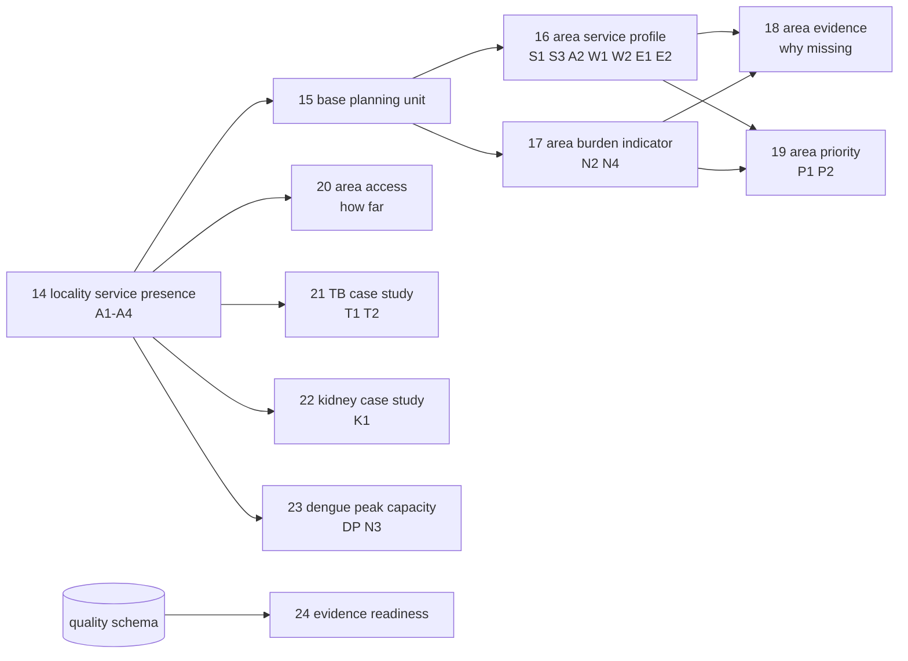

# Gold — data marts

Owner: LUNASaan Documentation Team
Last updated: 2026-10-21

The marts turn the model into answers. Each mart is a **view** that answers one group of business questions for the dashboard. For each mart, this page gives the question, the row, the method, the rules and the reasons. [Metric definitions](metric-definitions.md) holds the formulas. The [data dictionary](data-dictionary.md) holds the columns.

Status date: 2026-10-20. Back to the [gold overview](README.md).

---

## 1. Why the marts are views

| Choice | Why | Cost |
|---|---|---|
| Every mart is a view | Always current: a gold rebuild needs no mart rebuild, and a mart can never be out of step with its tables | The view runs on each read. `fact_area_access` computes about 1,640 × 530 locality pairs; make it a table if the dashboard is slow (to-do 24) |
| Marts read the model, never silver | The model's gates and QC already protect them | — |
| Marts never invent a figure | When a fair comparison is not possible, the row says why (`exclusion_reason`, `mapping_outcome`) | The dashboard must show the reason |
| Every unit gets a row, with or without a value | A missing area is visible, not silently dropped | Rows with null values |

Views have no build id and no row in `quality.build_log`. Gold QC check G09 confirms each one is readable and not empty after every run.

## 2. Map: questions to marts

## 3. The BQ1 spine

### 3.1 `mart_locality_service_presence` (gold 14)

**Question.** A1: which cities and municipalities have no hospital recorded? A2: what is the highest hospital level recorded? A3: which have no licensed primary care facility recorded? A4: how many people per hospital, bed and primary care facility?

**One row:** one city or municipality, with or without a facility.

**How.**

- Start from every city and municipality in `dim_geography`, then left join the registry rows of `fact_facility_capacity`. A locality with no facility has no capacity row, so the left join is what makes "none recorded" visible.
- Sum the registry rows over ownership and level. That is correct for the registry: each facility sits in exactly one group.
- Join the latest census population of the locality (`fact_area_indicator`, census, ok).
- Manila submunicipalities have no row. The City of Manila row counts their facilities.

**Rules and why.**

| Rule | Why |
|---|---|
| "Recorded" is literal. Write "none recorded as of <registry_as_of_date>" | The registry can miss facilities (O-02) |
| Hospital and primary care flags stay separate | They answer different questions: hospital care vs early care (D-26) |
| A count is 0 when the registry lists nothing. `hospital_beds` is null when the registry lists hospitals but none has a bed count | A missing bed count is not zero beds |
| A4 ratios only where the count is above 0 | "People per hospital" has no value without a hospital. The flag shows that case |

### 3.2 `mart_base_planning_unit` (gold 15)

**Purpose.** One list of planning units, each with one census denominator, so marts 16 to 19 compare the same units on the same population.

**One row:** one planning unit (province excl. HUCs, HUC, NCR, `other`).

**How.** Roll the localities of mart 14 up to `planning_unit_key`. Population = sum of the localities' census counts in the latest census year.

| Rule | Why |
|---|---|
| Sum the localities, not the census province row | The province row's coverage differs by census year. The 2024 row excludes HUCs. Nobody has confirmed 2015 and 2020. Localities do not overlap and come from one source, so their sum is exact |
| Population is null if any locality lacks a count | A partial sum would understate the denominator and inflate every rate. `localities_without_population` says how many are missing |
| Sulu stays null | The source has no 2024 count for Sulu. Using 2020 for one unit would mix census years in one ranking (D-41) |

### 3.3 `mart_area_service_profile` (gold 16)

**Question.** S1, S3: how many beds and health centres per population? W1, W2: how many doctors, nurses, midwives and BHWs per population? E1, E2: how do they relate to poverty? A2: highest hospital level.

**One row:** one planning unit.

**How.**

| Indicator group | Source | How it reaches the unit |
|---|---|---|
| Hospitals, beds, licensed primary care | Registry (mart 14) | Sum of the unit's localities: exact by construction |
| BHS, health centres | FHSIS published counts | Through `area_coverage_map`: a `direct` row, or **all** parts of an `aggregate` |
| Doctors, nurses, midwives, BHW | FHSIS workforce (preferred, eligible) | Same, through the coverage map |
| Poverty incidence | PSA poverty | A `direct` row only; a percentage is never summed |

**Rules and why.**

| Rule | Why |
|---|---|
| A unit with a missing or ineligible part gets null, never a partial sum | A partial sum looks like a low value and would flag a gap that is a data gap |
| Each indicator keeps its own year (`workforce_year`, `bhw_year`, `fhsis_count_year`, `poverty_year`) | Sources publish different years. The mart shows the latest usable year of each, with its label |
| Census denominator for cross-domain rates; FHSIS-printed population for the two FHSIS facility rates | FHSIS published its counts on the FHSIS population's coverage. A mixed rate is wrong where the two populations differ (D-39) |
| 2-year alignment window | A 2025 count over a 2015 population is not a rate of today (O-15) |
| Quintile 1 = lowest, ties share a quintile | Ranking is relative; equal values must not land in different groups by chance |
| `poverty_band` is display only | No flag or score uses it; round cut-offs keep the legend readable (D-56) |

### 3.4 `mart_area_burden_indicator` (gold 17)

**Question.** N2: where are modelled deaths and prevalence highest? N4: where are TB notifications highest?

**One row:** one planning unit × one burden indicator (disease, measure, source) in that source's latest year. Every unit gets a row for every indicator.

**Indicators.**

| Indicator | Source | How it reaches the unit |
|---|---|---|
| TB notifications, all forms | FHSIS (reported) | Sum of the unit's localities. A unit with a locality missing keeps the partial count but no rate |
| Modelled deaths and prevalence of focus diseases and CKD | IHME (modelled) | `direct` rows of `area_coverage_map` only |

**Not here, and why:**

- **Dengue.** The province source (HDX) ends in 2021 and lags DOH from 2018 (D-45). Mart 23 covers dengue.
- **TB programme indicators.** They are case-study measures (mart 21).
- **PhilHealth claims.** They measure use of care, not burden.

| Rule | Why |
|---|---|
| One source per indicator, the preferred one in `source_priority` | Sources are never mixed. A reported count and a modelled estimate are two indicators |
| IHME rows only where `direct` | IHME provinces include their HUCs (D-42), so a province with a HUC covers more than its planning unit. It gets `province_estimate_includes_its_huc`; the HUC itself gets `published_only_inside_the_province_estimate`. Mart 22 compares them as broad units |
| Bounds stay with their estimate, never summed | Uncertainty intervals do not add |
| IHME attribution on every chart | Licence |

Exclusion reasons: `locality_without_report`, `no_source_row`, `province_estimate_includes_its_huc`, `published_only_inside_the_province_estimate`, `no_population`, `outside_alignment_window`.

### 3.5 `mart_area_evidence` (gold 18)

**Purpose.** "N units compared, M excluded, and why" for every indicator. It reshapes marts 16 and 17 into one long list and computes nothing new.

**One row:** one planning unit × one indicator.

| Column | Meaning |
|---|---|
| `value_available` | The unit has a value |
| `coverage_compatible` | The source's area maps to the unit (`direct` or `aggregate`) |
| `comparison_eligible` | The unit enters comparisons on this indicator |
| `exclusion_reason` | Why not, in the words of the mart that owns the indicator |

**Why it exists.** A null is never a zero and never dropped silently. This view is what the dashboard's "about the data" page reads.

### 3.6 `priority_weight_params` and `mart_area_priority` (gold 19)

**Question.** P1: which units combine high burden with service gaps, and which kind of gap? P2: how stable is that ranking when the weights or the missing-value rule change?

**One row:** one planning unit × burden indicator × weight set × eligibility rule.

**Gap flags** (true, false or null; null = input missing, never "no gap"):

| Flag | True when | Why this rule |
|---|---|---|
| `has_hospital_gap` | Beds per 10,000 in the lowest fifth | Relative question: where are gaps largest (D-56) |
| `has_primary_care_gap` | Health centres per 10,000 in the lowest fifth, **or** the share of residents in a locality with no licensed primary care recorded in the highest fifth and above 0 | Two independent measures of early care; either one is enough. `primary_care_gap_basis` says which |
| `has_workforce_gap` | At least **two of three** core professions (doctors, nurses, midwives) per 10,000 in the lowest fifth. Null unless all three are known | One profession's reporting gap cannot raise it alone (D-56) |
| `has_socioeconomic_flag` | Poverty incidence in the highest fifth | Equity side of BQ1 |
| `is_high_burden` | Burden rate in the highest fifth, counted from the top | Need side of BQ1 |

**Score and rank.**

- `flags_count` = flags raised, unweighted.
- `score` = weighted flags ÷ total weight of the flags the unit has (0 to 1).
- `eligibility_config`: `complete_only` ranks a unit only with all four flags known and a burden rate; `rescale_missing` ranks it with at least two known flags, spreading the missing weight over the known ones.
- `rank` 1 = highest score; ties broken by burden rate.

**Weight sets** (`priority_weight_params`): `equal` (default, 0.25 each), `supply_heavy`, `equity_heavy`. Why: no gap type has a basis to count more, so equal is the default; the other two are sensitivity tests. A claim rests on the units that stay at the top under all three (D-56).

**Reading rule.** Show the flags and the gap type first; show the score only next to them. Default view: `weight_set = 'equal'` and `eligibility_config = 'complete_only'`.

## 4. Access

### 4.1 `fact_area_access` (gold 20)

**Question.** The "how far" part of A1 and A2.

**One row:** one city or municipality, with three straight-line distances:

| Distance | To | Note |
|---|---|---|
| `nearest_hospital_locality_km` | Centre of the nearest locality with a hospital recorded | 0 if the locality has one itself. Not a distance to a building: the registry has no coordinates |
| `nearest_level3_locality_km` | Same, Level 3 hospital | 0 for its own Level 3 |
| `nearest_osm_hospital_point_km` | Nearest OSM point tagged hospital, exact coordinates | Unverified, uneven coverage. Map-layer indication only |

**Why straight line.** The platform has no road network. Great-circle (haversine) km with an Earth radius of 6,371 km is the honest measure the data supports. It is optimistic across water. Label every distance "straight-line".

**Why two sources.** The registry is official but has no coordinates; OSM has coordinates but is crowd-sourced. Showing both, labelled apart, lets disagreements point to registry matches worth checking.

The name starts with `fact_`, but it is a mart view, not one of the four model facts. The name stays because the dashboard reads it.

## 5. Case studies

### 5.1 `mart_tb_case_study` (gold 21): prevention

**Questions.** T1: do localities with higher TB notification rates have fewer health workers per population, and how many have no licensed primary care or hospital recorded? T2: how much TB preventive treatment reaches eligible contacts, and what share of treated cases succeed?

**One row:** one city or municipality.

| Rule | Why |
|---|---|
| TB = FHSIS notifications, all forms, 2024 and 2025, ok rows only | The only source at locality level. Notifications reflect detection and reporting |
| Every rate uses the 2024 census population | T1 as written in the proposal; one denominator year for every column |
| Workforce = FHSIS 2025, preferred, eligible | 2025 is the first year FHSIS publishes it by locality |
| `bhw_per_10k` is null for 2025. The mart shows `bhw_lgu_hired_per_10k` with a label instead | FHSIS 2025 prints LGU-hired BHW only |
| The mart computes programme rates. It never copies the printed percentages | Nobody can check or roll up the printed percentages |
| The label calls `tpt_eligible_contacts` an estimate | FHSIS computes it as notified cases × 4 × 70% |
| The mart flags small cohorts (`ds_small_cohort`, `mdr_small_cohort`: cohort under 10). It does not hide them | A 100% success rate on 2 patients is real but fragile |
| This mart names its sources directly (`doh_fhsis`, `doh_fhsis_demographic`) | Both match the preferred rules; if `source_priority` changes, update this file |

### 5.2 `mart_kidney_case_study` (gold 22): specialist treatment capacity

**Question.** K1: which provinces have high modelled CKD mortality but few dialysis stations recorded per population?

**One row:** one province (or NCR) as IHME publishes it. `unit_basis` = `planning` (no HUC, or NCR) or `broad` (province plus its HUCs).

| Rule | Why |
|---|---|
| Burden = IHME CKD deaths (`ihme_589`), all ages, both sexes, latest year | Modelled; never mixed with registered deaths |
| The mart compares provinces with HUCs as **broad units**. Population and stations include the HUCs | IHME provinces include their HUCs (D-42). Setting `ihme_includes_huc_confirmed = true` |
| Dialysis = facilities with a recorded station count, plus free-standing clinics without one | A hospital without a station count may have no dialysis unit |
| Null stations = not reported | Missing is not zero |
| Placed under specialist treatment, not prevention | Dialysis is treatment (D-39) |

**Comparison gates**, in order; a row that fails keeps its numbers and names the first failed gate:

1. The unit has a population (`no_population`).
2. Burden year and census year at most 2 years apart (`outside_alignment_window`).
3. Planning unit, or IHME coverage confirmed (`ihme_province_coverage_not_confirmed`; no longer appears since D-42).
4. At least 80% of the unit's dialysis facilities have a station count (`station_counts_incomplete`). Why 80%: the mart skips stations per 100,000 when more than a fifth of the facilities have no count (D-56).

### 5.3 `mart_dengue_peak_capacity` (gold 23): preparedness

**Questions.** DP: where were historical dengue peaks largest relative to current recorded hospital capacity? N3: when and where does dengue peak, how concentrated is it, and where is the burden high year after year?

**One row:** one area × one dengue source × one year.

| Source | Grain | Years | Use it for |
|---|---|---|---|
| `hdx_dengue` | Province or city × week ending <date> | 2016–2021 | Comparing provinces. From 2018 its peaks are 1–2 weeks late (D-45) |
| `upnoah` | Region × ISO week | 2016–2019, 2022–2025 | Regional peak timing (D-46) |
| `doh_foi_dengue` | Region × month | 2021–2025 (2025 to September) | Regional peak timing; restricted |

| Rule | Why |
|---|---|
| The source is part of the key; never mix sources in one ranking | Weekly and monthly peaks are not comparable |
| `peak_label` = `peak` only for complete years, else "highest observed period" | A missing week could hold the true peak |
| Repeat high burden counts complete or near-complete years (at least 50 weeks or 12 months) | HDX has one-week source gaps (2019 misses ISO week 1 everywhere) |
| Capacity = registry analysis beds of the **same coverage** as the published row | A province row that excludes its listed cities uses the beds of the province minus those cities |
| `peak_cases_per_100_beds` is a relative figure for ranking | Nothing here converts cases to admitted patients or bed-days. "Would exceed capacity" is BQ2, stretch 2 |
| HDX labels read "week ending <date>" | Each HDX date closes its week (D-44). `dim_date` keeps the bare date because it is part of the key |

## 6. Monitoring

### 6.1 `mart_evidence_readiness` (gold 24)

**Question.** Is each silver and gold table built, checked and built from the latest inputs? It feeds the dashboard's readiness page.

**One row:** one silver or gold table in its latest succeeded build. Filter `schema_name = 'gold'` for the published layer; the build log still holds rows of the old test schemas.

| Column | Rule |
|---|---|
| `is_fresh` | No input has a newer succeeded build than the version this build read (same rule as gold QC G06) |
| `qc_pass` / `qc_warn` / `qc_fail` | The latest QC of every script that checks the table |
| `approval` | Provisional until every input passes silver QC and someone reviews its warnings |

**Not covered:** tables written by notebooks (geography, population, boundaries), seeds and views have no build row. G09 checks the views and seeds instead.

## 7. Rules for every mart query

| Rule | Why |
|---|---|
| Keep nulls as nulls; show `exclusion_reason` or `mapping_outcome` | A blank is information |
| Show the as-of date of the registry and the year of every indicator | Sources have different dates |
| Label every denominator | Census and FHSIS populations differ |
| IHME attribution with modelled values; "© OpenStreetMap contributors" with OSM | Licences |
| Restricted data: aggregates only, cells under 3 suppressed | D-47 |
| "Lowest 20% of planning units", never "inadequate" | No national norm (D-56) |

## 8. History of updates

| Date | Change |
|---|---|
| 2026-10-12 | First marts written (`gold_41`–`gold_71`, first model) |
| 2026-10-14 | Marts rewritten for the combined model; reviewer's five points applied (D-39) |
| 2026-10-18 | Renumbered `gold_14`–`gold_24` |
| 2026-10-19 | Mart 17 exclusion reason renamed. Mart 21 small-cohort flags added. Mart 22 compares broad units (D-42). Mart 23 check 3 added. Mart 24 `model` column dropped. Values agreed (D-56) |
| 2026-10-20 | Mart 23 HDX label "week ending <date>". Page written |
| 2026-10-20 | Rewritten in short, active sentences |
