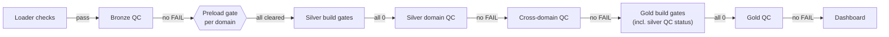

# Quality control framework

This page sets the rules for every quality check. It covers where checks run, what stops the pipeline, how a check gets its status, where results go, and how to add or change a check. The [check catalog](quality-check-catalog.md) lists each check. The [lineage and quality contract](lineage-and-quality-contract.md) fixes the identifiers and lineage behind them.

Status date: 2026-10-20. Back to the [quality overview](README.md).

---

## 1. Principles

| Principle | Meaning in practice |
|---|---|
| Check before the next layer starts | Every layer's QC runs before the layer that reads it. A FAIL stops the job there |
| Protect the write, then record it | Build gates stop a bad candidate before publishing; QC scripts check the published table and store the result. Both exist on purpose |
| Never change data in a check | QC reads and records. It never fixes, deletes or moves a data row |
| Set aside with a reason, never drop | An unusable row gets a `row_disposition` with its reason. S29 checks the share |
| One meaning per code | A code is never reused or renamed; a new idea gets a new code |
| No typed numbers in the logic | Expected values live in `config/sources_<domain>.yaml` or in the settings a build records (`build_log.parameters`); a missing value fails the check (rule 2a) |
| Faithful versus correct | Bronze checks that a load is faithful to its file. Silver and gold check meaning, rules and agreement between sources |

## 2. The gate chain

| Step | Where | Stops on | What stays as it was |
|---|---|---|---|
| Loader checks | Each bronze loader, per source | Header, required columns, decoding, no data rows; rows in table ≠ rows read | The loader writes nothing for that source. The load log gets a `failed` row |
| Bronze QC | `run_bronze.py`, after each domain's load | Any FAIL | The run stops before the next domain |
| Preload gate | `bronze_gate.py`, one job task per domain | A source in FAIL, CRASHED, STALE or NOT_CHECKED | That domain's silver does not start |
| Silver build gates | Inside each build file (`__gates` table, or the Python gate in geography and population) | Any gate with failures > 0 | The published table; a `failed` row in `build_log` |
| Silver QC | `<domain>_silver_qc.py`, then `silver_cross_domain_qc.py` | Any FAIL | The job stops before gold |
| Gold build gates | Inside each gold build file | Any gate > 0, including a silver input whose latest QC has a FAIL | The published gold table |
| Gold QC | `gold_qc.py` | Any FAIL | Anything that depends on it (dashboard refresh) |

A WARN never stops the chain. QC records it and lists it in `v_open_issues`. A person reviews it.

### What the checks look for

| Kind | Question | Examples |
|---|---|---|
| Existence | Is the table there, with rows? | B01, S01, G01 |
| Completeness | Did every file, row and period arrive? | B02, B03, S09, S54, G09 |
| Uniqueness | Is each key and grain unique? No double load? | B06, S03, G02, G03 |
| Validity | Are types, vocabularies and ranges correct? | B15, S11, S66, G11 |
| Integrity | Does every key resolve? | S37, S49, G04 |
| Consistency | Do values, statuses and bases agree? Do totals equal their parts? | B12, S36, S68, G08 |
| Accuracy | Do the numbers match a published control or the layer below? | B11, S10, S21, S34, G07 |
| Timeliness | Was the table built from the latest inputs? Is the source recent? | S16, S33, S98, G06 |
| Auditability | Did the check run? Is the table the one the build wrote? | B00, S00, G00, S30, G05 |
| Idempotency | Does a rerun give the same content? | G12 |
| Business monitoring | Is a change plausible? | S58, S94, G13 |

The seven programme attributes map onto these kinds as a proposal (O-06); see the [quality overview](README.md).

Bronze also re-checks itself: an unchanged source whose last QC did not clear is re-queued by `run_bronze.py` (D-50), so a fix in the YAML `qc` block clears it without touching the file.

## 3. Severity

| Severity | Use it when | Effect |
|---|---|---|
| **FAIL** | The table is wrong, incomplete or untraceable. Examples: a missing file, lost or doubled rows, broken lineage, a control that doesn't match, a key that isn't unique | The script raises an error at the end. The job stops |
| **WARN** | The table is a faithful copy, but the source has a gap or disagreement a person should read: repeated rows, sources that disagree, a total that doesn't add up, a value to verify | Recorded; does not stop |

Choosing a severity for a new check: if the published number could be wrong because of what the check found, it's FAIL. If the number is right but its source is imperfect, it's WARN.

## 4. How a check gets its status

`dq_utils.DQRun.record()` decides the status:

| Mode | Rule |
|---|---|
| Given | The check passes PASS, or its severity, directly |
| Plain | From `fail_count` / `total_count`: PASS when the failing share ≤ `threshold` (default 0), otherwise the check's severity |
| Banded | Uses `warn_threshold`, `min_fail_rows` or both. PASS up to the warn line. WARN up to the threshold, or when failing rows ≤ the row floor. Above both, the check's own severity. S29 uses it (WARN up to 5% or 10 rows) |
| Value | Observed = expected (numbers within 0.0005), otherwise the check's severity |

When a check raises an error, QC records `B00`, `S00` or `G00` FAIL for its table with the error text. The other tables still run. The run fails at the end. A missing setting or control counts as such an error. So nobody can switch a check off by deleting its input.

## 5. Where results go

All in `public_health.quality`, append-only:

| Table | Written by | Holds |
|---|---|---|
| `qc_results` | Every QC script | One row per check: identity, check, status, severity, counts, observed, expected, detail |
| `run_log` | Every QC script | One row per execution: script, layer, domain, times, status (PASS / WARN / FAIL / ERROR), check counts |
| `table_stats` | Every QC script | Row count and Delta version of each table checked |
| `profile` | QC scripts (not for restricted tables) | Null, blank, distinct, min, max per column |
| `quarantine` | Silver QC (not for restricted sources) | Set-aside rows as JSON, replaced per check scope on each run |
| `build_log`, `build_inputs` | Every silver and gold build | One row per build; one row per input it read |
| `row_disposition` | Every silver build | One row per bronze row read but not loaded, with a reason |
| `check_registry` | `quality_registry_seed.sql` | Code, name, type, default severity and threshold |

`ingestion_metadata` (in `bronze`) is the load log: one row per file or sheet per bronze run, with status `processed`, `failed` or `skipped_duplicate`.

Views for reading: `v_latest_results`, `v_table_health`, `v_open_issues`, `v_run_errors`, `v_latest_build`, `v_build_lineage`, `v_qc_results_identity`, `v_build_reconciliation`.

## 6. Identity of a result

| Column | Holds |
|---|---|
| `batch_id` | What was checked: `<source_key>:<content_checksum>` for a bronze file; `build:<build_id>` for a silver or gold table or candidate |
| `validation_id` | The QC execution; joins `qc_results`, `run_log`, `table_stats`, `profile` |
| `run_id` | The job run, when the job passes `{{job.run_id}}`; otherwise the validation id |
| `table_name`, `source_key`, `layer` | Where |

`table_stats` links a result to the Delta version it checked, and through `build_log.target_table_version` to the build that wrote that version (contract, section 8.1).

## 7. Thresholds, overrides and settings

| Kind | Where it lives | Rule |
|---|---|---|
| Expected rows, control totals and values | `qc` block of the source's YAML entry | Named per file. A new file fails until a person verifies the value and updates the YAML |
| Silver controls | The same `qc.control_values` items, with a `silver:` block saying where the value sits in silver | One number, checked in bronze and in silver |
| Build settings (years, counts, cut-offs) | `build_log.parameters` of the build that wrote the table | QC reads them back; a table built without them is S00 FAIL |
| Gold settings and reviewed lists | Step [0] of each gold file holds the settings. `build_log.parameters` records them. Reviewed lists (sources, named areas, professions) are views. Gold counts them into `build_inputs.input_rows` | No query types a number that the logic depends on (D-62). The [seed data](../gold/seed-data.md) page lists the gold settings in section 9 |
| Policy constants (S29 limits, S97 bands, S99 tolerance, S58 30%, S94 15 points, S07 ±50%) | Named constants in the QC script, one comment each | Part of what the check means; change them with a reason in the comment |
| Bronze overrides | `qc.skip_checks`, `qc.severity` in the YAML | Known codes only. Never `B00`. WARN or FAIL only. B01's detail records every override (D-53) |

Silver and gold have no overrides. To change a check, edit the script. The pull request review covers the change.

## 8. Set-aside rows

| Mechanism | Layer | Rule |
|---|---|---|
| `row_disposition` | Silver builds | Every bronze row read but not loaded: `dropped_non_data`, `duplicate_of`, `quarantined` (with reason), `merged_into` |
| Accounting check | Silver builds and S09 | Rows read = bronze rows; rows silver references = rows read − rows not loaded ([reconciliation](../silver/reconciliation.md)) |
| Accepted reasons | Diseases S45 | A quarantined row with any reason other than the reviewed one fails |
| Share limit | Cross-domain S29 | WARN above 0; FAIL above 5% **and** above 10 rows of a source |
| Copy for review | `quality.quarantine` | The quarantined bronze rows, for a reviewer; never for restricted sources |

## 9. Restricted data in quality tables

For `sharing: restricted` sources and their silver tables (D-47):

- no column profile (a minimum or maximum would copy a record value);
- no quarantine copy (no row leaves the table);
- counts and row references only in `qc_results` and `row_disposition`;
- IHME `value_lower` and `value_upper` left out of profiles (licence).

## 10. Expected WARNs

A WARN is expected when its layer page lists it with a reason:

- bronze: [bronze quality checks](../bronze/bronze-quality-checks.md), section 11;
- silver: [silver quality checks](../silver/silver-quality-checks.md), per domain and section 14;
- gold ([gold validation](../gold/analytical-validation-and-traceability.md), section 4):
  - G12 differs once after a rule change that rebuilds rows, such as the weekly `date_key` after D-44;
  - G13 warns when a boundary or code change moves a census population;
  - G07 claims warns when suppressed region cells make gold lower than silver.

A WARN that is not listed is a finding: explain it on the layer page, or add it to the [backlog](../../08-governance/known-issues-and-backlog.md).

## 11. Adding or changing a check

1. Take the next free code in the layer's range ([catalog](quality-check-catalog.md), section 1). Never reuse one.
2. Pick the severity with the rule in section 3.
3. Read every number it needs from the YAML or the build's settings, or derive it; fail the check (S00) if it is missing.
4. Write it through `DQRun` with a `detail` that names the failing rows or groups.
5. Add the code to `quality_registry_seed.sql`, the catalog and the layer page in the same pull request.
6. Run it on Databricks once and record the result before relying on it.

## 12. Limitations

| Limitation | Treatment |
|---|---|
| `check_registry` is not fully seeded; `strict_registry=False` except population QC | O-17, to-do 7 |
| No drift checks (row counts, key sums against the previous run) except gold G12 | Backlog |
| No automatic rerun-equality check in silver | Gold G12 covers the published model; backlog for silver |
| Each silver QC script holds its own lineage expectations | Shared `silver_tables.yaml` in the backlog (to-do 15) |
| Marts are views with no build row | `mart_evidence_readiness` does not cover them |

## 13. History of updates

| Date | Change |
|---|---|
| 2026-10-07 | Quality schema and `DQRun` (D-14, D-15) |
| 2026-10-09 | Build records and row dispositions (contract v1.2, v1.3) |
| 2026-10-18 | Gold QC (D-48) |
| 2026-10-19 | Bronze re-queue and preload gate added (D-50, D-51). Overrides validated (D-53). Rule 2a: no typed numbers in silver QC |
| 2026-10-20 | Page written (silver chat) |
| 2026-10-20 | Merged with the gold pass: kinds of check, gold settings (D-62), gold expected WARNs |