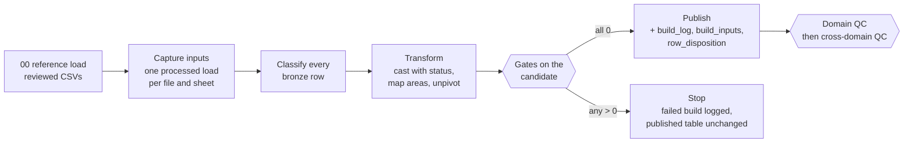

# Silver layer

Owner: LUNASaan Documentation Team
Last updated: 2026-10-21

Bronze keeps every file exactly as it arrived. Silver turns those files into clean, comparable tables: every row means one thing (one disease count for one area and period, one facility, one population figure for one area and year), and every area is named the same way, by its PSGC code from one shared geography table. Nothing is guessed. A label that matches no rule is set aside with a reason, never dropped and never forced.

Every silver row still points to the bronze file, sheet and row it came from, and every build records which files, loads and reference tables it read. Rates, rankings and the choice of preferred source are left to gold. Silver only makes the inputs trustworthy and comparable.

This page is the overview. The full reference (run order, every table, gates, check codes, rerun and recovery) is [`src/03_silver/README.md`](../../../src/03_silver/README.md).

## Pages in this folder

| Page | What it covers |
|---|---|
| [geography.md](geography.md) | The PSGC spine (`geography_silver`) and the HDX boundaries matched to it |
| [population.md](population.md) | Census population 2015 / 2020 / 2024 from the PSGC payload |
| [diseases.md](diseases.md) | Disease counts, deaths by age, TB programme, coverage, and the two restricted hospital tables |
| [facilities.md](facilities.md) | Facility registry, published facility counts, bed occupancy, OSM health sites |
| [workforce.md](workforce.md) | Health worker headcounts, FHSIS population denominators, oncologist listings |
| [socioeconomic.md](socioeconomic.md) | Poverty, health expenditure, child mortality |
| [reference-maps.md](reference-maps.md) | How labels become PSGC codes and disease keys: builders, reviewed CSVs, review status |
| [reconciliation.md](reconciliation.md) | How every bronze row is accounted for in silver, and how to produce the evidence |
| [silver-quality-checks.md](silver-quality-checks.md) | Every silver check: build gates, domain QC, cross-domain QC, severities, settings, what to do on a failure |
| [rebuild-strategy.md](rebuild-strategy.md) | Why silver rebuilds in full on every run, and the cost recommendations |

## How every build works

Every observation table is built the same way (write-audit-publish):

1. **Reference load.** Load the reviewed CSVs. Stop if a code is not in geography or the CSV was built from another geography snapshot or workbook.
2. **Capture inputs.** List every bronze file and sheet the build reads, and find its load in `bronze.ingestion_metadata`. Exactly one processed load per input, or the build stops.
3. **Classify every bronze row:** `data`, `non_data`, `duplicate`, `quarantined` or `unclassified`. An unclassified row stops the build.
4. **Transform** in SQL: cast each value with a status (`ok`, `no_report`, `not_published` …), reshape wide to long, map areas and causes before reshaping, combine sources.
5. **Gates on the candidate:** every area resolves, codes exist in geography, every cell is a number or a documented marker, keys are unique, counts reconcile, control totals match, the file layout is the one expected.
6. **Stop on failure:** a `failed` row in `quality.build_log`, then the build raises. The published table is not touched.
7. **Publish and record:** the table is replaced from the validated candidate, then `build_log`, `build_inputs` and `row_disposition` are written.
8. **QC** on the published table, per domain, then across domains.

Numbers about the files (expected rows, control values, report years, thresholds) are not typed inside the code. Control values live in `config/sources_<domain>.yaml`; years and thresholds are named settings at the top of each build file and are recorded in `build_log.parameters`, where the QC reads them. A file with a year or layout the build does not expect stops the build instead of loading part of it.

## Lineage

| On every silver row | Once per build |
|---|---|
| `_silver_build_id`, `_source_key`, `_source_file`, `_source_sheet`, `_source_row_num`, `_as_of_date`, `_metric_source_columns` (which bronze column each value came from, where a row was reshaped) | `build_inputs`: load id, file checksum, load time, input table version. `build_log`: status, row count, target table version, settings |

Rows combined from two sources keep one lineage group per side (for example `_nhfr_*` and `_hfsrb_*`). The contract is [lineage-and-quality-contract.md](../quality/lineage-and-quality-contract.md).

## Write pattern

| Pattern | Tables | Rerun on unchanged inputs |
|---|---|---|
| Full rebuild from a validated candidate | All observation tables | Same rows; a new build id and `build_log` row; the old version stays in Delta history |
| MERGE on a key | `geography_silver`, `admin_boundaries_silver` | 0 inserts, 0 updates |
| Rebuild that carries its keys forward | `facilities_id_map_silver`, `facilities_registry_silver` | Same `facility_key` for every facility; 0 business changes |

Full rebuild is a decision (D-57): at current volume it is cheap, every gate sees the whole table, and a rule change reaches every row at once. See [rebuild-strategy.md](rebuild-strategy.md).

## Reference maps

Reviewed CSVs translate what a source says (a label, a cause name, a hospital id) into what the platform means (a PSGC code at a level, a `disease_key`). They are generated by builder scripts from the geography table and reviewed before they are committed; they are never edited by hand. A manual decision is a row in the builder's decision table, with reviewer and date. Details: [reference-maps.md](reference-maps.md).

| Domain | Reference tables |
|---|---|
| Diseases | Area map, cause map, disease directory, cause aggregation |
| Facilities | Area exceptions, identifier overrides |
| Workforce | Area exceptions, row overrides (bound to the workbook checksum), PSMO exceptions |
| Socioeconomic | Poverty area map, with coverage basis and comparison eligibility |

## Rules gold must follow

| Rule | Meaning |
|---|---|
| Counts only | Silver holds published counts. Gold computes rates |
| Null is not zero | A missing value is null with a status. A real 0 stays 0 |
| Never sum across sources, levels, grains or value types | Published totals (`ph`, `all_causes`) are their own rows |
| Sum causes only through the cause aggregation table | The only approved way to add causes |
| Respect the coverage basis | `geo_coverage_basis` and `comparison_eligible` say whether a province figure includes its highly urbanized cities |
| Series breaks are flags, not fixes | Hospitals 2013, nurses 2019, claims 2020–2021 and 2024, and others listed per domain |
| ISO weeks | Weekly rows use `iso_week` or `iso_week_ending_date` (D-44, D-46) |

## Restricted tables

Three tables come from FOI releases or a hospital extract: `diseases_hospital_encounters_silver`, `diseases_hospital_claims_silver` and `facilities_bed_occupancy_silver`. Under D-47 they are used for academic purposes and aggregate reporting only: never profiled, never copied to the quarantine table, published by gold only as aggregates with cells from fewer than 3 records or hospitals suppressed. IHME rows follow the IHME licence. See [data governance](../../08-governance/data-governance.md).

## Quality

| Level | What it checks | Where results go |
|---|---|---|
| Build gates | Everything that must hold before publishing (all FAIL) | `__gates` staging table; summary in `build_log` |
| Domain QC | The published table: keys, lineage, freshness, reconciliation, controls, accepted values, codes in geography, domain rules | `quality.qc_results` |
| Cross-domain QC | Quarantine share per table (gate), future years, ratios per population, source age, FHSIS vs census population | `quality.qc_results` |

Any FAIL stops the job before gold. WARNs are kept for a person to read; the expected ones are listed on each domain page. Every silver check in detail: [silver quality checks](silver-quality-checks.md). Codes of all layers: [quality check catalog](../quality/quality-check-catalog.md). Results of the recorded runs: [quality results and evidence](../quality/quality-results.md).

## Scope

Silver does: cast, reshape, classify every bronze row, resolve areas to PSGC through reviewed maps, keep sources side by side, carry lineage, gate before publishing, set rows aside with a reason.

Silver does not: compute rates, choose a preferred source, add across causes, levels or sources, or publish restricted rows. Those are gold.

## Limitations

| Area | Limitation |
|---|---|
| Geography | No crosswalk from highly urbanized cities to their province; comparisons that include them are flagged, not solved. One PSGC snapshot (Q2_2024) for all years |
| Coverage | Coverage of IHME, HDX dengue, some poverty provinces and Basilan is not confirmed by the providers; flagged in `geo_coverage_basis` |
| Weeks | The ISO week convention (D-44, D-46) is a team decision, verified on the data, not confirmed by the providers |
| Review rows | A few rows are set aside or flagged for review (TB rows of the Special Geographic Area, some claims area pairs, Davao and San Jose labels). They are listed in the backlog |
| Engineering | Full rebuild on every run (D-57); bronze is read at its current version, so silver runs right after bronze QC; reference copies in the repo and the Volume are synced by hand |

Open items and recommendations: [known issues and backlog](../../08-governance/known-issues-and-backlog.md). Decisions: [decision log](../../08-governance/decision-log.md).
