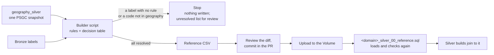

# Silver — reference maps

Owner: LUNASaan Documentation Team
Last updated: 2026-10-21

Sources name the same place, disease or hospital in many ways. Reference maps are reviewed CSVs that translate what a source says (a label, a cause name, a hospital id, a row) into what the platform means: a PSGC code at a level, a `disease_key`, a `facility_key`. Silver never matches by guessing. A label is resolved by a rule, by a reviewed decision, or it is set aside with a reason.

The reference for the files is in the repo: `builders/readme.md` (one section per builder) and `config/reference/readme.md` (one row per CSV). Back to the [silver overview](README.md).

## How a map is made

1. **A builder generates the CSV.** It reads the bronze labels and the geography table, applies the matching rules, then applies the decision table for what the rules can't resolve.
2. **It stops instead of guessing.** A label with no rule and no decision, or a code that isn't in geography at the stated level, stops the builder. It writes nothing to the reference folder, only a list of what needs a decision.
3. **A person reviews the diff** against the committed copy and commits it in the same PR as the change that caused it (a new file, a new PSGC snapshot, a decision).
4. **The Volume copy is updated** (`<landing_root>/reference/<domain>/`), which is what silver reads.
5. **The domain's `00_reference.sql` loads it and checks it again:** no duplicate keys, every code in geography, the file built from the current geography snapshot or workbook version. Any failure stops the load.

Builders are not pipeline steps. No job task runs them; the pipeline reads only the reviewed output.

## Rules

| Rule | Why |
|---|---|
| Generated CSVs are never edited by hand | A manual decision is a row in the builder's decision table, with reviewer and date. A hand edit would be lost on the next run |
| Codes come from `geography_silver` only | One PSGC snapshot for every domain (D-30). After a new snapshot, every builder is rerun |
| Every column is text | PSGC codes keep their leading zeros. Never open and save the CSVs in Excel |
| Column order is fixed | `00_reference.sql` reads by position with a fixed schema |
| Stale maps stop the load | Facilities exceptions carry the geography checksum they were built from; workforce overrides carry the workbook checksum they were reviewed against |
| Unresolved means held back | A label with no usable row is never matched by name; its rows are quarantined or flagged with a reason |

## Maps per domain

| Domain | Builder | Reference CSVs | What they hold |
|---|---|---|---|
| Diseases | `build_diseases_reference_maps.py` | `diseases_area_map`, `diseases_cause_map`, `diseases_directory`, `diseases_cause_aggregation` | Area label or source id → `area_key` and PSGC code, with coverage basis; row-level overrides; cause label or code → `disease_key`; the disease directory (becomes `dim_disease`); approved cause groupings that sum to a total. PhilHealth claims hospital locations and case-rate packages |
| Facilities | `build_facilities_area_exceptions.py` | `facilities_area_exceptions`, `facilities_area_decisions` (record only), `facilities_id_map_override` | Place labels the join can't resolve (NHFR, HFSRB, FHSIS, bed occupancy, OSM `addr:city`), each with rule, evidence and status; reviewer decisions; manual facility identity |
| Workforce | `build_workforce_area_exceptions.py` | `workforce_area_exceptions`, `workforce_psmo_area_exceptions`, `workforce_area_override` | FHSIS and PSA region and area labels; PSMO regions, NCR districts and composite areas; row-level overrides bound to the workbook checksum |
| Socioeconomic | `build_socioeconomic_poverty_area_map.py` | `socioeconomic_poverty_area_map` | PSA poverty areas → PSGC code, coverage basis, comparison eligibility, first estimate year |

One more builder prepares a landing file, not a map: `build_hdx_healthsites_csv_from_geojson.py` fills the coordinates the Healthsites CSV leaves blank for building outlines (D12).

## Matching order

Every domain resolves an area in the same order; the first that applies wins:

1. **Reviewed row override:** one bronze row, bound to the file version it was reviewed in.
2. **The source's own code**, where it prints one (NHFR, FHSIS 2025, FHSIS TB), checked against geography.
3. **Reviewed exception:** a label the rules can't resolve, with its decision.
4. **Name rule:** normalised name, plus level, plus parent region. Exactly one candidate is accepted.

Zero candidates, or more than one, is not a match. What happens next differs by domain: the workforce builder stops until it has a decision. The diseases builder keeps unresolved hospital-encounter city labels with a blank area key for review. The facilities builder quarantines rejected rows.

## Review status

Some decisions carry a status:

| Status | Effect in silver |
|---|---|
| `accepted` | The row takes the reviewed area and is used normally |
| `proposed` | The row takes the proposed area but stays out of analysis (`analysis_eligible = false`, reason `label_under_review`), and silver QC lists it (workforce S79) |
| `rejected` | The row stays excluded from area rankings |

Open reviews, as of 2026-10-20: four workforce overrides `proposed` (Taguig and San Juan 2022, Surigao del Norte and Alegria 2025); 21 claims location pairs marked `REVIEW`; 34 Davao labels and San Jose (Oriental Mindoro). They are deferred to after submission (D-58, to-do 13). Accepted on 2026-10-20: Zamboanga Sibugay 2025, whose printed code is not a PSGC code (D-58).

## Changing a map

1. Change the builder's decision table (with reviewer and date where the table has them), rerun the builder, read its report.
2. Review the diff and commit it with the change that caused it.
3. Upload the CSV to the Volume.
4. Rerun the domain's `00_reference.sql` (every check must return 0), then the silver builds that read it, then the domain QC and the cross-domain QC.

Silver QC catches a map that is out of date: the freshness checks (S16, S63, S83) fail when a reference table changed version and row count after the build.

## Limitations

- Builders run by hand, outside the job, and the repo and Volume copies are synced by hand (backlog: a CI check that they are identical).
- Decision tables live in Python; moving them to reviewed CSV or YAML is in the backlog (to-do 16).
- There is no crosswalk from highly urbanized cities to their province; comparisons that include them are flagged, not solved (to-do 19).
- One PSGC snapshot (Q2_2024) serves every year.
