# Dashboard on public_health.gold (2026-10-21)

Owner: LUNASaan Documentation Team
Last updated: 2026-10-21

Screenshots of the dashboard after the [final runs](../2026-10-21-final-runs/README.md), and what they show.

**Result:** pages 0, 2, 3 and 4 render with data on every widget captured. One widget is wrong (claims bottom 15) and five need small fixes. Pages 1 and 7 are not captured yet.

---

## 1. Dashboard

| Item | Value |
|---|---|
| Dashboard | Philippine Public Health Platform (`dashboard/Philippine Public Health Platform.lvdash.json`), deployed by the bundle |
| Published pages | 6: 0. National Overview · 1. Need · 2. Access to early care · 3. Gaps and equity · 4. Reported care (PhilHealth claims) · 7. About the data |
| Draft pages | 5. Case studies and 6. Preparedness are in the definition but excluded from the published view (`excludeFromPublished`) |
| Datasets | 46, all reading `public_health.gold` |
| Changes on 2026-10-21 | `test_gold2` → `gold` in every dataset. Backup, "for redesign" and earlier copies of pages 0–4 removed. `model` removed from the P7 pipeline-status table. 18 unused datasets removed. Page 7 renamed "7. About the data" |
| Captured | 2026-10-21, in the dashboard editor (draft on branch `fix/population-y…`), before the cleaned definition was deployed. The eye-slashed tabs in the screenshots are the earlier page copies that the cleaned definition removes |

## 2. Screenshots

Named `dashboard_<page><part>.png`, top of the page first.

| Page | Screenshot | Shows |
|---|---|---|
| 0. National Overview | 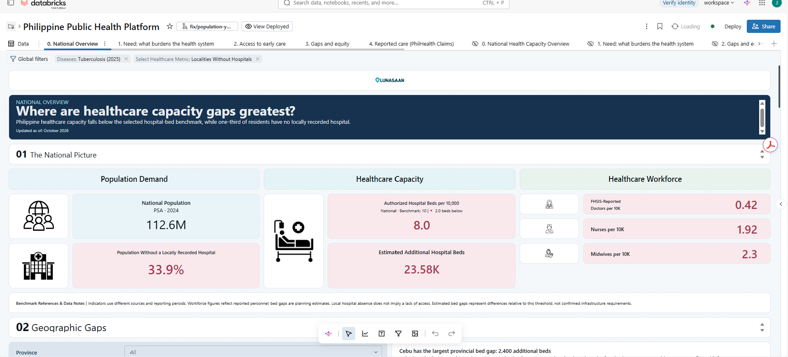 | Headline tiles: population 112.6M, 8.0 beds per 10,000 (benchmark 10), 33.9% without a locally recorded hospital, 23.58K additional beds, workforce per 10,000 |
| | 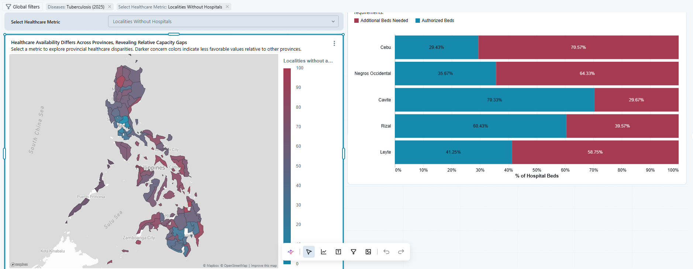 | Province map (localities without hospitals) and the top five provincial bed gaps |
| | 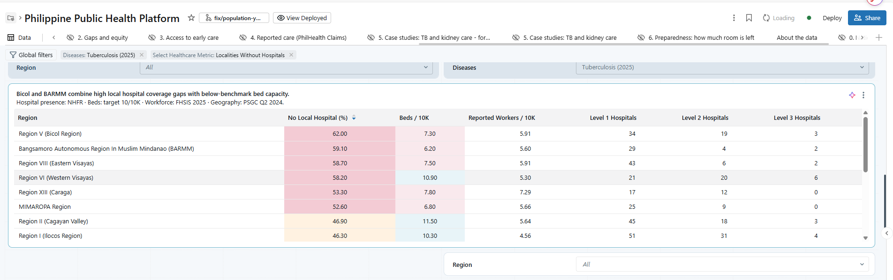 | Region table: no local hospital (%), beds and workers per 10,000, hospitals by level |
| | 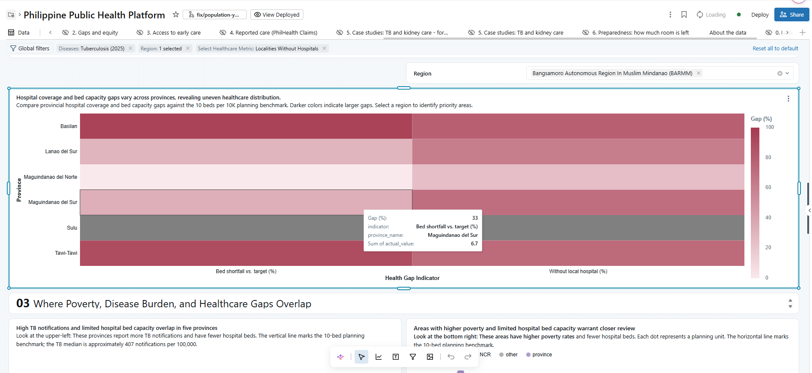 | Province heatmap for one region (BARMM selected): bed shortfall and no local hospital |
| | 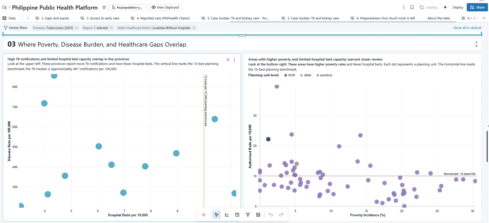 | TB rate vs beds, and poverty vs beds, with the 10-bed benchmark |
| | 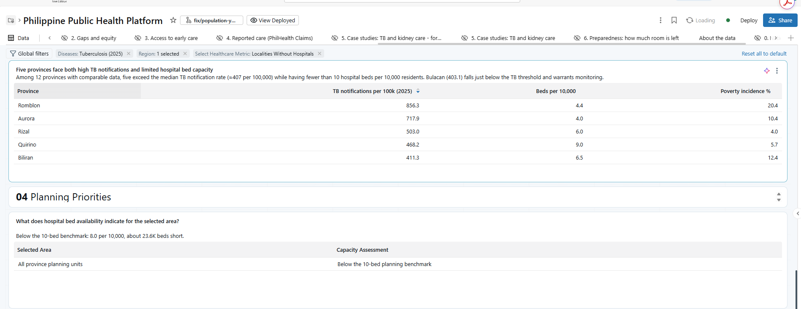 | Five provinces with high TB and low beds; planning summary for the selected area |
| 2. Access to early care | 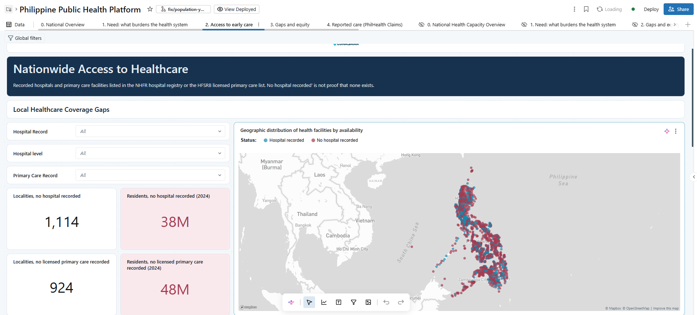 | Localities and residents with no hospital (1,114; 38M) or no licensed primary care (924; 48M) recorded; facility map |
| | 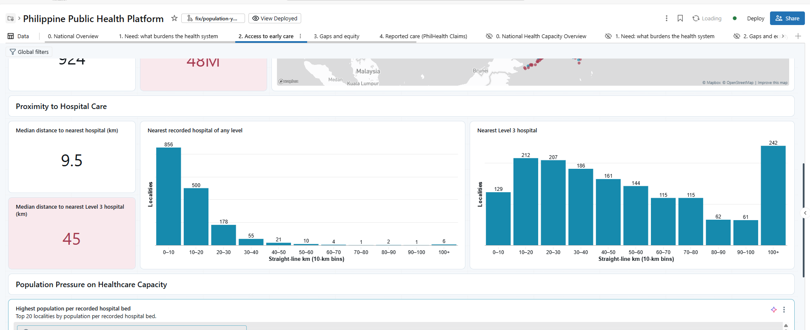 | Median distance to nearest hospital 9.5 km, to Level 3 45 km; distance distributions |
| | 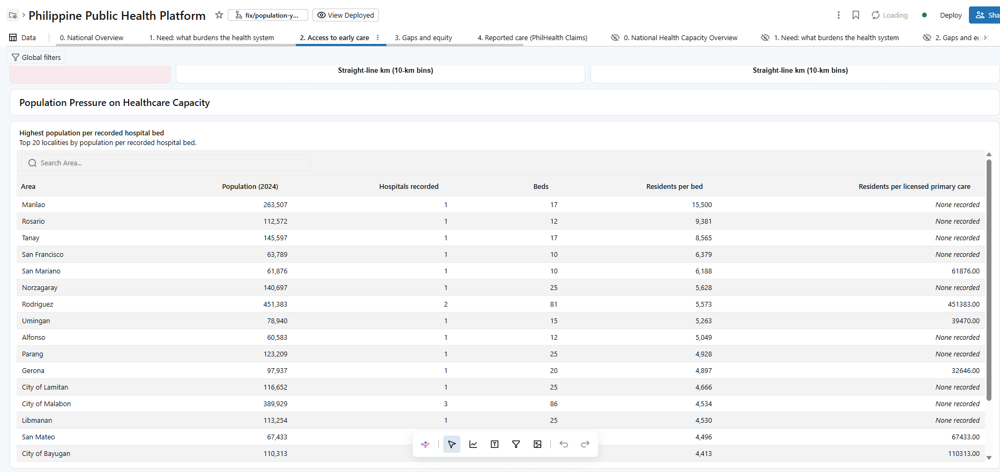 | Top 20 localities by residents per recorded hospital bed |
| 3. Gaps and equity | 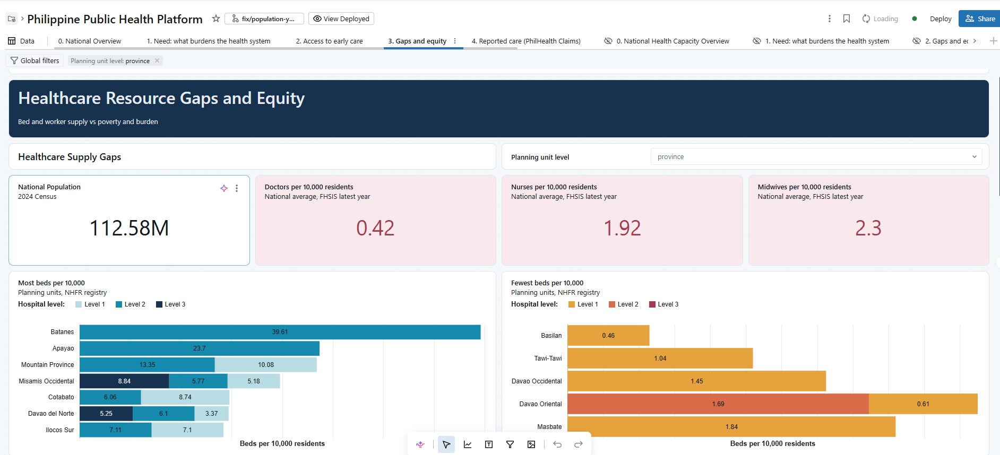 | Population and workforce tiles; most and fewest beds per 10,000 by hospital level |
| | 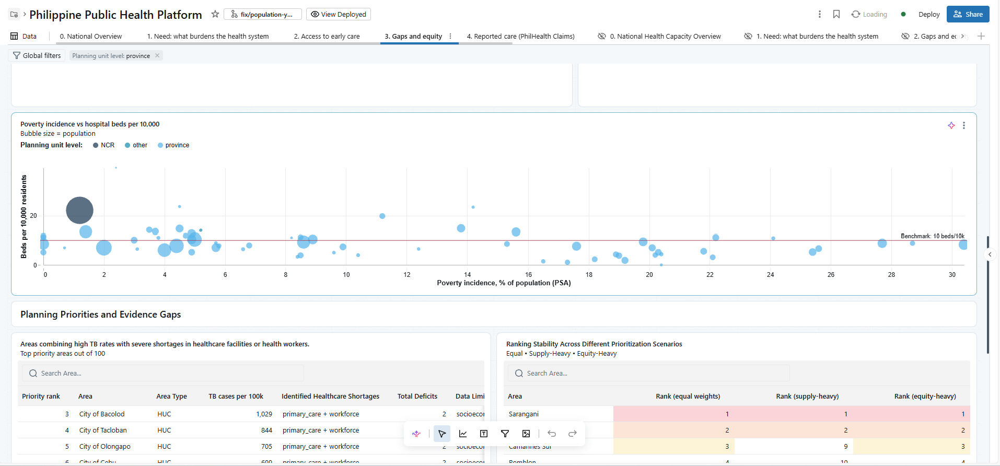 | Poverty vs beds per 10,000; start of planning priorities |
| | 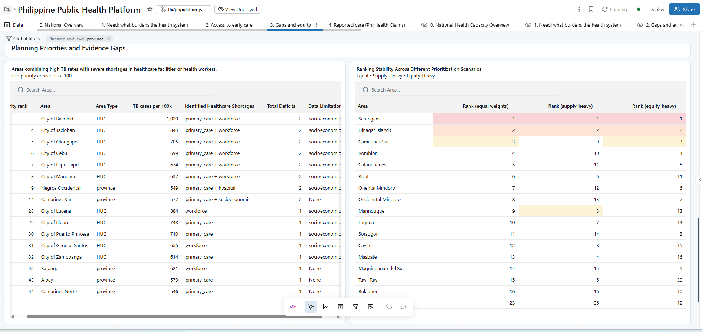 | Priority areas (TB plus shortages) and ranking under three weightings |
| 4. Reported care | 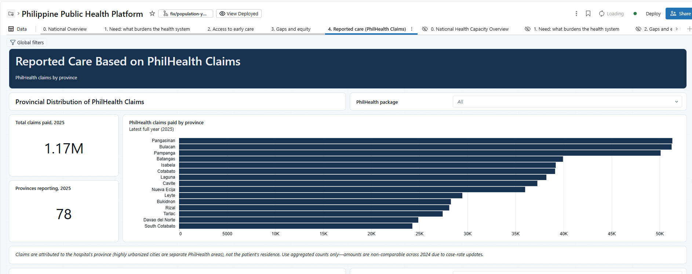 | Claims paid 2025: 1.17M total, 78 provinces reporting, top provinces |
| | 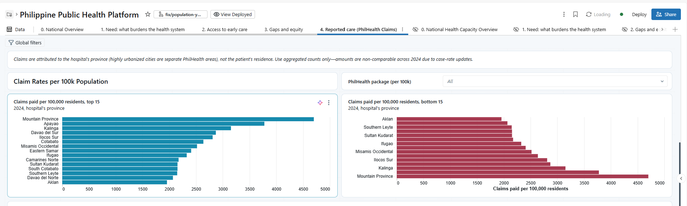 | Claims paid per 100,000 residents (2024), top 15 and bottom 15 |
| | 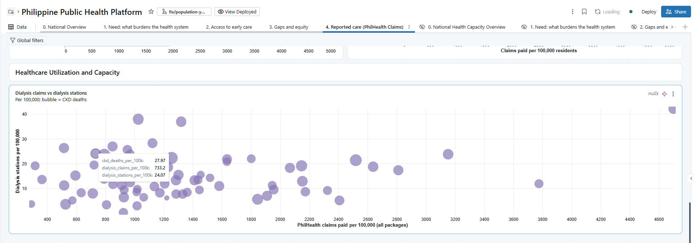 | Dialysis claims vs dialysis stations per 100,000; bubble size = CKD deaths |

Restricted data: page 4 shows claims only as province aggregates (D-47). No screenshot shows an individual hospital record.

## 3. Issues found

| # | Page | Widget | Issue | Fix |
|---|---|---|---|---|
| 1 | 4 | Claims per 100,000, bottom 15 | **Wrong data.** It shows the same 15 provinces as the top 15 (Mountain Province … Aklan), sorted low to high. The widget's 15-category limit keeps the largest values | Open |
| 2 | 2 | Top 20 residents per bed, column "Residents per licensed primary care" | Values show unformatted (`61876.00`) while other columns use separators | **Fixed** in the definition: the dataset returns `format_number(…, 0)`; nulls still show "None recorded" |
| 3 | 3 | Poverty vs beds; priority table | The page filter "Planning unit level: province" doesn't apply: NCR, HUC and "other" points still show | Open: wire the filter, or remove it |
| 4 | 3 | Priority table | Priority rank starts at 3; ranks 1 and 2 (Sarangani, Dinagat Islands in the ranking table) are not listed | Open: confirm they drop out for missing TB data and say so in the subtitle |
| 5 | 0, 4 | Heatmap, dialysis scatter | Tooltips show raw column names (`Sum of actual_value`, `ckd_deaths_per_100k`). The scatter shows a "nulls" badge (provinces with missing values left out). Sulu is grey (no value) | Open: set display names; note the excluded provinces |
| 6 | 3 | Most and fewest beds | Hospital levels use different colours in the two charts (Level 1 light blue vs orange) | Open: one colour per level |

## 4. Still to capture

- Page 1 (Need) and page 7 (About the data, including the pipeline-status table).
- Pages 0–4 again from the deployed dashboard after the cleaned definition is deployed, so the tabs show only the published pages.

## 5. History of updates

| Date | Change |
|---|---|
| 2026-10-21 | Record written: dashboard definition switched to `public_health.gold`; page screenshots still to capture |
| 2026-10-21 | Screenshots of pages 0, 2, 3 and 4 added (15 images); six widget issues listed, one fixed. Page count corrected: 6 published, 5 and 6 are drafts |
