# New-workspace run: full pipeline from empty (2026-10-21)

Owner: LUNASaan Documentation Team
Last updated: 2026-10-21

One full run of the bundle job in a new Databricks workspace with empty tables. It shows that the pipeline builds every layer from the landing files alone and gets the same result as the [final runs](../2026-10-21-final-runs/README.md).

**Result:** the job succeeded:
- every bronze source loaded for the first time, with 0 failed;
- all 28 silver and gold tables were built once;
- G12 recorded a first fingerprint for all 9 gold tables;
- QC found 0 FAIL in every layer, and gold QC has the same 2 standing WARNs as the final runs;
- every row count that can be compared matches the final runs.

Recorded with the seven queries in [`evidence_queries.sql`](../evidence_queries.sql), right after the run. Times are UTC, with Manila in brackets. Screenshots are in this folder, numbered as in the [evidence guide](../README.md), section 4.

---

## 1. Run

| Item | Value |
|---|---|
| Workspace | New workspace; no `public_health` tables before this run (I1 and I2 show no earlier build or QC run) |
| Job | `[dev jhsantiago1] ph-public-health-pipeline`, job id `182700471913312`, deployed by the bundle (dev target) |
| Run id | `908246813677292`; setup ran as job `82602561574019` |
| Trigger | Manual |
| Started | 2026-10-21 05:38 UTC (13:38 Manila) |
| Ended | 2026-10-21 07:35 UTC (15:35 Manila) |
| Duration | 1h 27m 50s of task time |
| Result | Succeeded, every task green |
| Repair | The first attempt stopped at `psgc_population` bronze QC: B00 "invalid qc block in the YAML" (runbook incident 8). After the `config/sources_population.yaml` fix, the run was repaired and finished. This is why the wall-clock time is about 30 minutes longer than the task time, and why `psgc_population` bronze QC is dated 06:41 |
| Code | Commit SHA not recorded |
| Metrics | 910 queries, 6,085,556 rows read, 553,940 rows written |

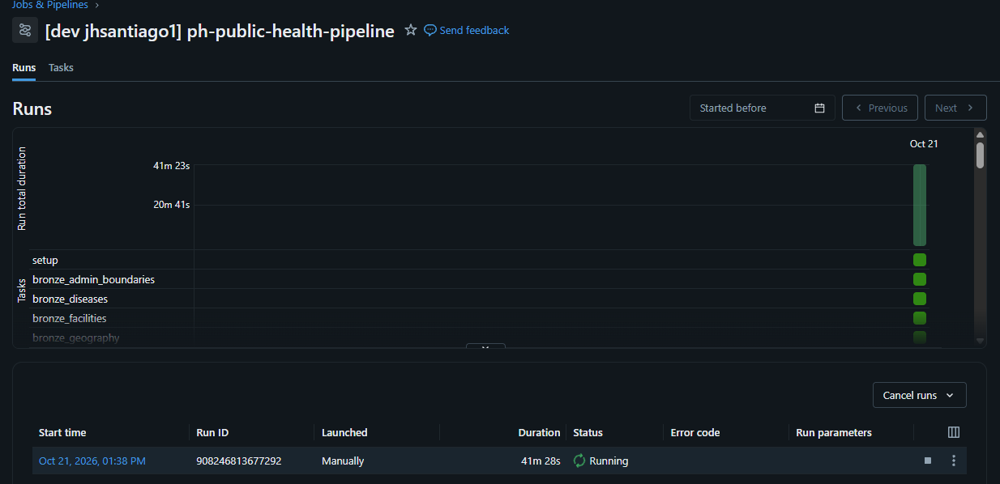

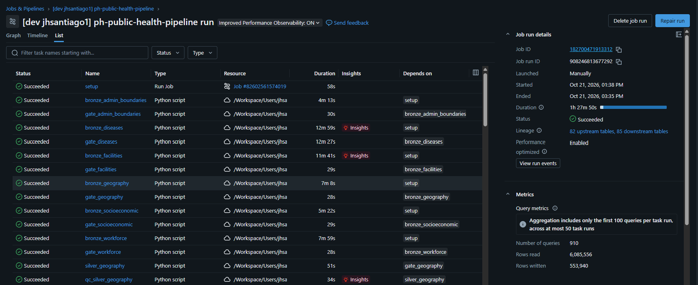

## 2. Timeline from the quality tables

| Step | Time (UTC) | Manila | Source |
|---|---|---|---|
| Bronze loaders: every file loaded | 05:40 – 05:44 | 13:40 – 13:44 | I3 |
| Bronze QC | 05:42 – 05:52 | 13:42 – 13:52 | S1 |
| `psgc_population` bronze QC, after the repair | 06:41 | 14:41 | S1, B1 |
| Silver builds | 05:47 – 07:16 | 13:47 – 15:16 | S2 |
| Silver QC | 06:43 – 07:21 | 14:43 – 15:21 | S1 |
| Gold builds | 07:24 – 07:25 | 15:24 – 15:25 | S2 |
| Gold QC | 07:28 | 15:28 | S1 |

## 3. Results

A first run in an empty workspace passes when every source loads with 0 failed, every table is built, G12 shows "first fingerprint", QC has no FAIL, and the row counts match the final runs.

| Query | Result | Pass? |
|---|---|---|
| B1 | The 3 expected bronze WARNs: B08 `philhealth_foi_claims_hospital`, B10 `psgc_population`, B08 `doh_fhsis_demographic`. All dated this run | Yes |
| S1 | 16 QC scripts, 0 FAIL. Bronze, silver and gold QC all dated this run. Gold QC 118 checks: 116 PASS, 2 WARN (`c83c1e41-3ced-4cf1-99de-d8e3cd99c190`) | Yes |
| S2 | All 28 silver and gold tables `succeeded`, finished during this run. Gold tables at Delta version 0 (`ref_osm_healthsite_point` 1): first write | Yes |
| G1 | 0 FAIL, 2 WARN: G13 (census boundary changes: Kalayaan, Makati, Pikit) and G07 (27 claims cells suppressed). Same as final runs 2 and 3 | Yes |
| I1 | One build per table (`run_1` and `run_2` empty). `same_count` false only because there is nothing earlier to compare with | Yes (first run) |
| I2 | `run_3` PASS "first fingerprint" for all 9 gold tables; no earlier gold QC run | Yes (first run) |
| I3 | 40 sources, each loaded with 0 failed. `no_reload` false is expected on a first load. `PSA PSGC` logged three times: loaded once, then skipped twice on the reruns (`no_reload` true) | Yes (first run) |

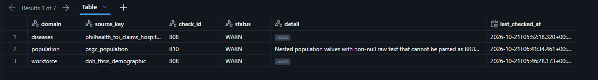
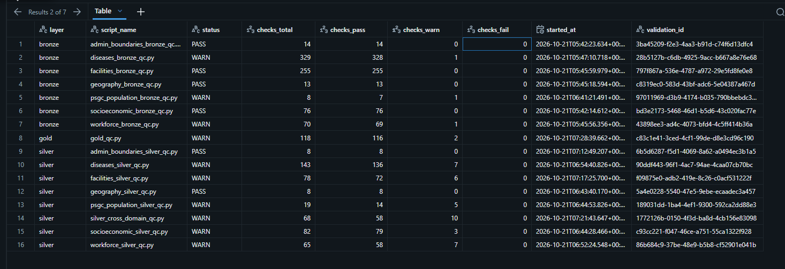
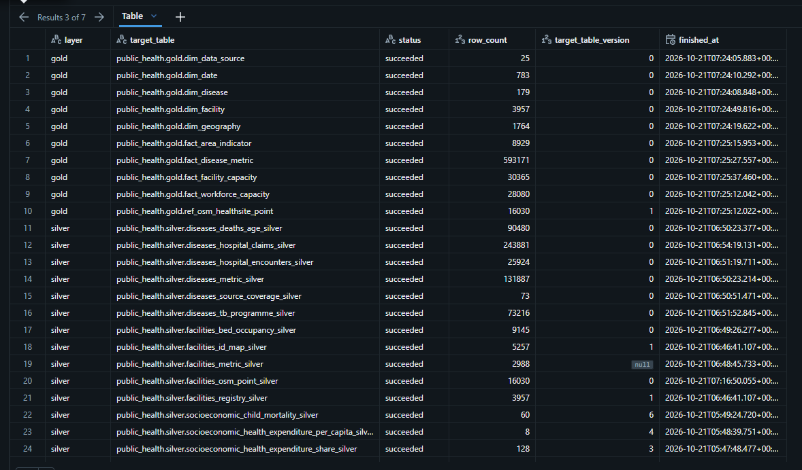
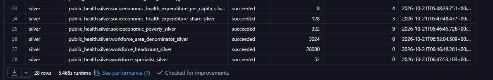
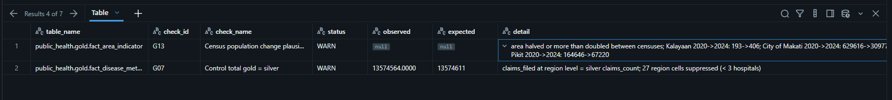
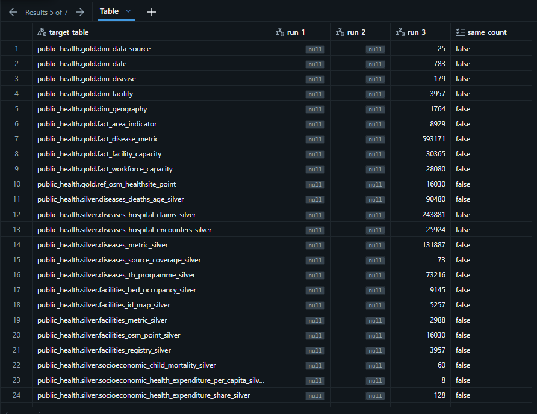
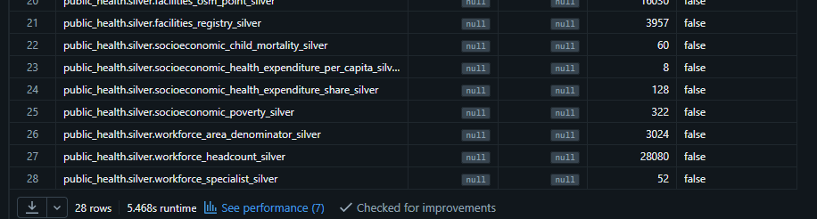
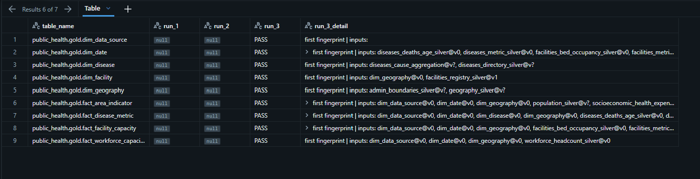
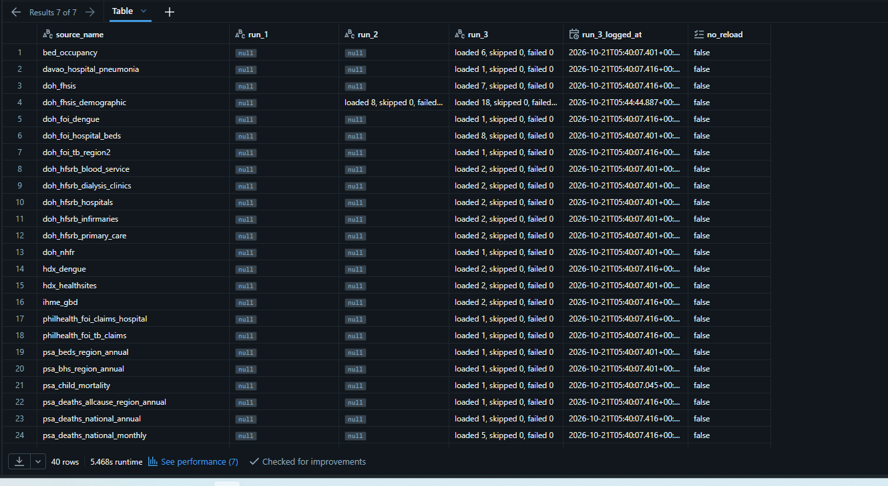
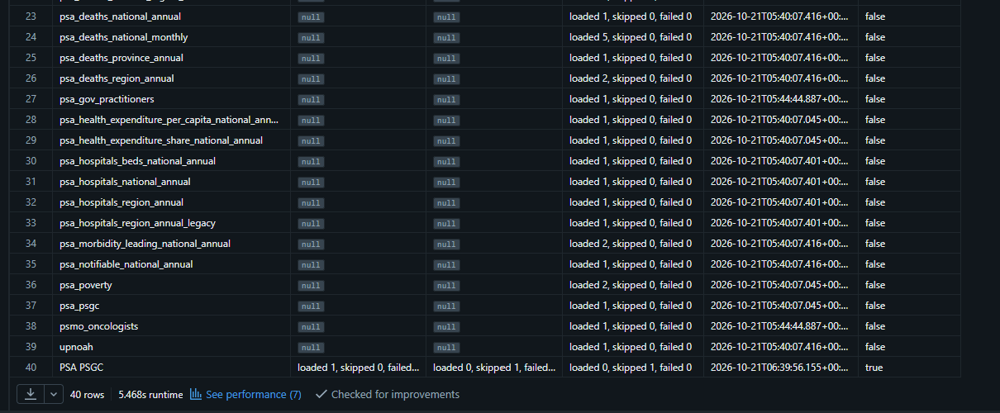

### Same result as the final runs

| Table | Final runs | This run |
|---|---|---|
| `gold.dim_geography` | 1,764 | 1,764 |
| `gold.dim_facility` | 3,957 | 3,957 |
| `gold.dim_disease` | 179 | 179 |
| `gold.dim_date` | 783 | 783 |
| `gold.dim_data_source` | 25 | 25 |
| `gold.fact_area_indicator` | 8,929 | 8,929 |
| `gold.fact_disease_metric` | 593,171 | 593,171 |
| `gold.fact_facility_capacity` | 30,365 | 30,365 |
| `gold.fact_workforce_capacity` | 28,080 | 28,080 |
| `gold.ref_osm_healthsite_point` | 16,030 | 16,030 |
| `silver.facilities_metric_silver` | 2,988 | 2,988 |
| `silver.workforce_area_denominator_silver` | 3,024 | 3,024 |

The final-run counts are from [run 1](../2026-10-21-final-runs/run-1/run-1.md), section 7, and stayed the same in runs 2 and 3 (I1).

## 4. What this run does not show

- **A rebuild outside Databricks.** The job, the Volume paths and the Delta tables are the Databricks implementation. The open-source path is in [reproducibility](../../07-operations/reproducibility.md) and has not been run yet (KI-20).
- **The deployed commit.** The SHA was not recorded.

What carries over to any platform: the landing files, the YAML and the documented run order were enough to build every layer from nothing, and the result matched the prepared workspace row for row.

## 5. Notes

- `facilities_metric_silver` logs a null `target_table_version` here too (backlog 7c).
- Some silver tables have a Delta version above 0 (for example `socioeconomic_poverty_silver` v9) because their build writes more than once in one run.
- The geography and boundary loaders don't log to `ingestion_metadata`. Their tasks (`bronze_geography`, `bronze_admin_boundaries`) succeeded, and the silver and gold geography tables were built from them.

## 6. History of updates

| Date | Change |
|---|---|
| 2026-10-21 | Record written from the job run page and the seven evidence queries |
| 2026-10-21 | Section 4 added: what this run does not show (rebuild outside Databricks, commit) |
