# Final run 1 of 3: full pipeline job (2026-10-21)

Owner: LUNASaan Documentation Team
Last updated: 2026-10-21

This record documents evidence run 1: the first full run of the final pipeline job (setup checks, bronze, gate, silver, silver QC, gold, gold QC). It is run 1 of the [three final runs](../README.md) of 2026-10-21; the method is in the [evidence guide](../../README.md), section 2.

**Result:** the job succeeded. QC found 0 FAIL in every layer. Every WARN is a known, expected WARN. Bronze reloaded nothing: every file was unchanged and skipped.

Recorded from the job run page, `quality.run_log`, `quality.qc_results`, `quality.build_log` and `bronze.ingestion_metadata`, using the seven queries in [`evidence_queries.sql`](../../evidence_queries.sql). Queries ran on 2026-10-21 at about 10:30 Manila time. Screenshots are in this folder, numbered in query order: 1 B1, 2 S1, 3 S2, 4 G1, 5 I1, 6 I2, 7 I3, 8 job run, 9 job details, 10 run history, 11 task graph; `a`/`b` are parts of one result.

**Time zones.** The job page shows Manila time (UTC+8). The quality tables store UTC (`+00:00`). This record gives UTC first, then Manila time in brackets.

---

## 1. Run

| Item | Value |
|---|---|
| Job | `[dev jemmalyn_santiago] ph-public-health-pipeline`, job id `587047839768584` (bundle job deployed to the `dev` target from `resources/ph_public_health_job.yml`) |
| Run id | `186099985728312` |
| Trigger | Manual (D-59: runs stay manual) |
| Started | 2026-10-20 20:49 UTC (2026-10-21 04:49 Manila) |
| Ended | 2026-10-20 22:13 UTC (2026-10-21 06:13 Manila) |
| Duration | 1h 11m 0s, the Databricks duration figure. It is shorter than ended minus started (1h 24m); the ⓘ next to Duration on the job page says what it leaves out |
| Result | Succeeded: every task green, including the `setup` task (runs the setup job) and the six `gate_<domain>` tasks |
| Code | Branch `dev`, commit **to fill** |

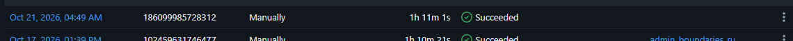

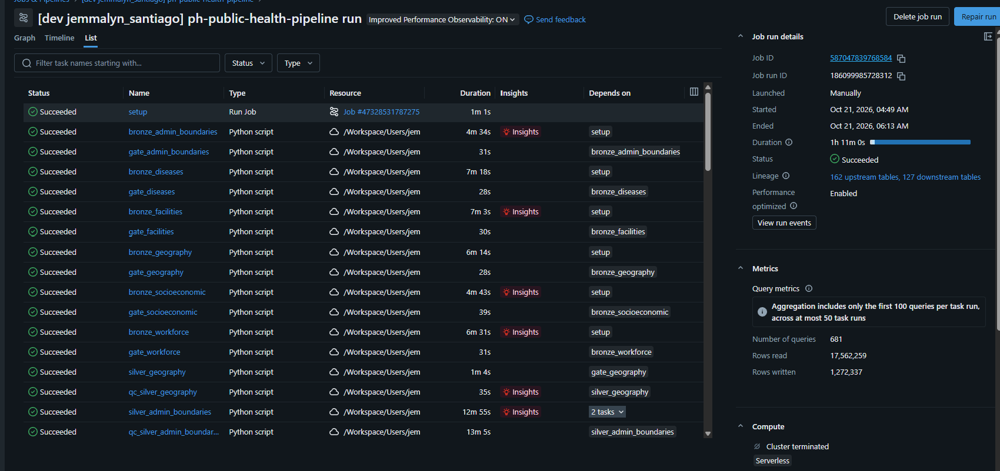

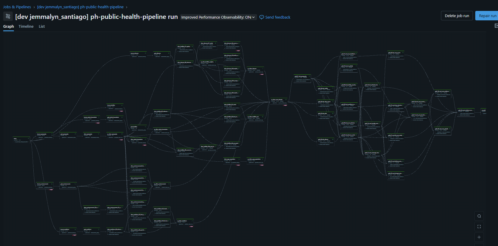

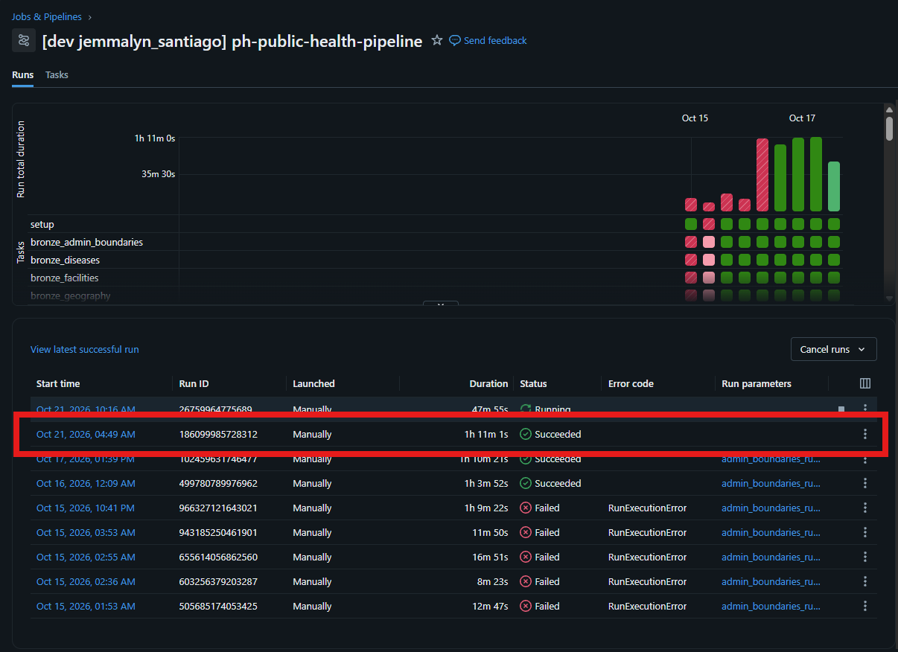

## 2. Timeline from the quality tables

| Step | Time (UTC) | Manila | Source |
|---|---|---|---|
| Bronze loaders: every file skipped | 2026-10-20 about 20:50 | 10-21 about 04:50 | I3 |
| First silver QC (socioeconomic) | 2026-10-20 21:01 | 10-21 05:01 | S1 |
| Silver builds (diseases, workforce denominator, OSM) | 2026-10-20 21:07 – 21:52 | 10-21 05:07 – 05:52 | S2 |
| Cross-domain silver QC | 2026-10-20 21:56 | 10-21 05:56 | S1 |
| Gold builds (9 model tables, OSM reference) | 2026-10-20 21:59 – 22:02 | 10-21 05:59 – 06:02 | S2 |
| Gold QC (`gold_qc.py`) | 2026-10-20 22:06 | 10-21 06:06 | S1 |
| Job ended | 2026-10-20 22:13 | 10-21 06:13 | Job page |

## 3. Why the timestamps differ

Three kinds of dates appear in the results. Each has a reason.

**Bronze QC dates are 2026-10-17 to 2026-10-19 (older than the run).**
- `run_bronze.py` loads only new or changed files. It compares each file with its last processed load: sha256 checksum, `as_of_date`, and the rows still in bronze.
- In this run no file was new or changed, so nothing loaded. Each file was logged as `skipped_duplicate` (I3).
- Bronze QC runs only for a source that was loaded or not yet cleared. No source qualified, so no bronze QC ran.
- The gate reads each source's latest QC result. Those results are from the last time each source loaded:
  - `psgc_population`: 2026-10-17
  - facilities, geography, admin boundaries, socioeconomic: 2026-10-18
  - diseases, workforce: 2026-10-19
- An old bronze QC date is therefore proof that bronze did not reload, not a missing run.

**Silver and gold dates are from this run (2026-10-20 21:00 – 22:07 UTC).** Silver and gold rebuild on every run. That is why their dates are new.

**Some silver rows are dated 2026-10-21 02:18 – 02:31 UTC (10:18 – 10:31 Manila), after this run ended.** These rows are not part of run 1:
- the bronze loaders ran again and skipped every file;
- facilities, socioeconomic and workforce silver were rebuilt with the same row counts;
- geography and PSGC population silver QC ran.

Gold and facilities, socioeconomic and workforce silver QC have no rows from that window. It is the next run of the same job (run id `26759964775689`, started 2026-10-21 10:16 Manila), still running when the queries ran. It writes to the same tables, so S1 and S2 show some of its rows (dated 2026-10-21 02:xx UTC).

## 4. Bronze

**B1: latest bronze QC per source, not PASS.** Three WARNs, all expected ([bronze quality checks](../../../04-pipeline/bronze/bronze-quality-checks.md)):

| Source | Check | Why it is expected |
|---|---|---|
| `philhealth_foi_claims_hospital` | B08 | 19 exact repeat rows in the source file. Silver sums them |
| `psgc_population` | B10 | Nested population values with raw text that does not parse as a number; set aside, not loaded |
| `doh_fhsis_demographic` | B08 | 6 identical rows with a blank `area_name` in the 2019 workbook. Silver drops blank-area rows |

No FAIL. The first version of B1 also listed three old FAIL rows. They came from runs that later runs fixed (HB00 on the old HDX handoff path, and B01/B13 on `psgc_population`). The query now reads only the latest QC run per source.

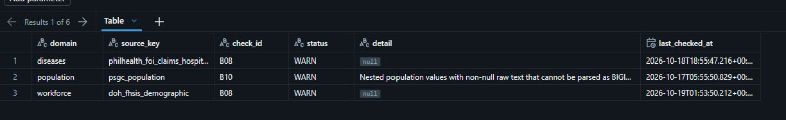

**I3: bronze loads in the last three loader runs.** All 40 sources show "loaded 0, failed 0" in all three runs; `no_reload` = true for every source. `doh_fhsis_demographic` logged 18, 8 and 18 skipped sheets: the number of sheets checked differs, but nothing loaded or failed.

PSGC geography and HDX boundaries are not file loaders. They show `unchanged` in the `run_bronze.py` task output instead.

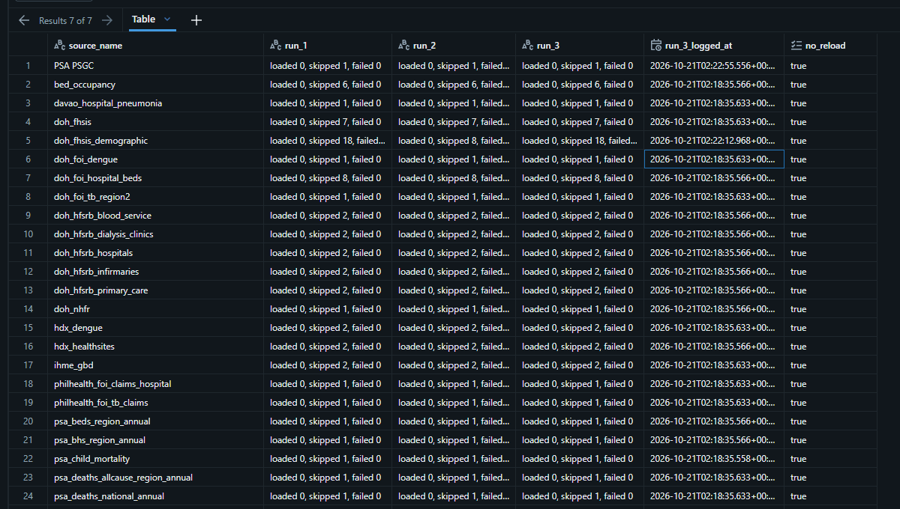
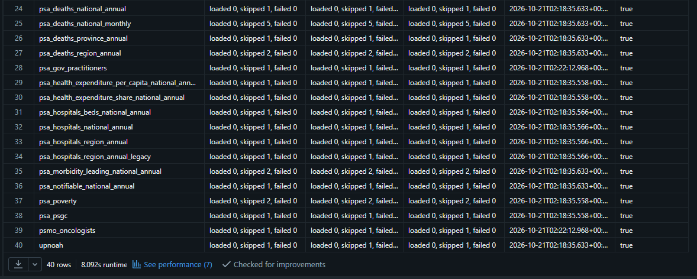

## 5. Silver

**S1: last run of every QC script.** 0 FAIL in every script.

| Script | Checks | PASS | WARN | FAIL |
|---|---|---|---|---|
| `admin_boundaries_silver_qc.py` | 8 | 8 | 0 | 0 |
| `diseases_silver_qc.py` | 143 | 136 | 7 | 0 |
| `facilities_silver_qc.py` | 78 | 72 | 6 | 0 |
| `geography_silver_qc.py` | 8 | 8 | 0 | 0 |
| `psgc_population_silver_qc.py` | 19 | 14 | 5 | 0 |
| `silver_cross_domain_qc.py` | 68 | 58 | 10 | 0 |
| `socioeconomic_silver_qc.py` | 82 | 79 | 3 | 0 |
| `workforce_silver_qc.py` | 65 | 58 | 7 | 0 |
| `gold_qc.py` | 118 | 111 | 7 | 0 |

The silver WARNs are the expected ones on the [silver quality checks](../../../04-pipeline/silver/silver-quality-checks.md) page. `population_silver_qc.py` (2026-10-17) is the old name of `psgc_population_silver_qc.py`; ignore that row.

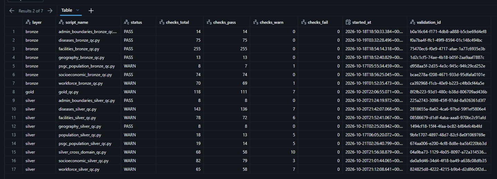

**S2: latest build of every silver and gold table.** All 28 tables `succeeded`. Gold was built 2026-10-20 21:59 – 22:02 UTC. `facilities_metric_silver` logs a null `target_table_version` (backlog 7c); it has no effect on the data.

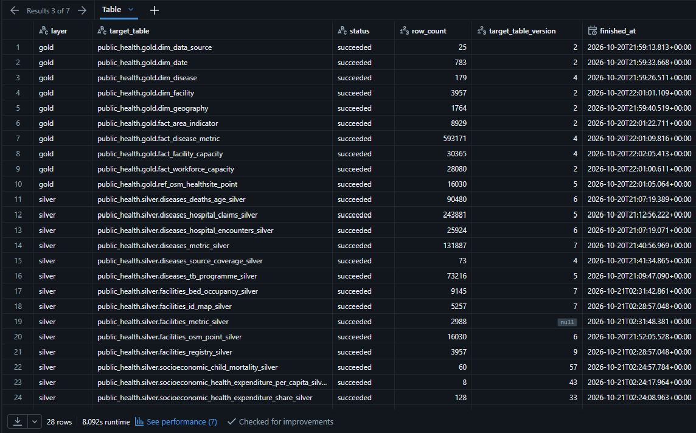
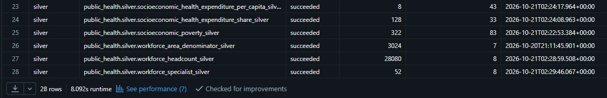

## 6. Gold

**G1: gold QC results not PASS.** 0 FAIL, 7 WARN, all expected:

| Check | Table | Why it is expected |
|---|---|---|
| G12 | `dim_data_source` | Same 25 rows; source notes changed in the gold pass (D-44, D-45, D-46) |
| G12 | `dim_date` | Same 783 rows; weekly `date_key` values changed (D-44, D-46) |
| G12 | `fact_disease_metric` | Same 593,171 rows; rows point to the new weekly `date_key` |
| G12 | `fact_workforce_capacity` | 28,071 → 28,080 rows: built from workforce silver as rebuilt on 2026-10-20 (Zamboanga Sibugay row override) |
| G12 | `fact_area_indicator` | 8,928 → 8,929 rows: workforce area denominator has one more area (3,023 → 3,024) |
| G13 | `fact_area_indicator` | Real boundary changes between censuses: Kalayaan 193 → 406, City of Makati 629,616 → 309,770, Pikit 164,646 → 67,220. Monitoring only |
| G07 | `fact_disease_metric` | Claims: gold 13,574,564 vs silver 13,574,611. Gold suppresses 27 region cells with fewer than 3 hospitals (D-47) |

**How G12 works.** For each gold table, gold QC computes a fingerprint `rows=<n>;hash=<sum of row hashes>` over every column except `_gold_build_id`. It compares the fingerprint with the previous gold QC run. Same = PASS ("same as previous"). Different = WARN. The detail lists each input table and its Delta version.

The five G12 WARNs compare this run with the gold QC run before the gold pass, when the code was different. They are expected once (evidence guide, section 2).

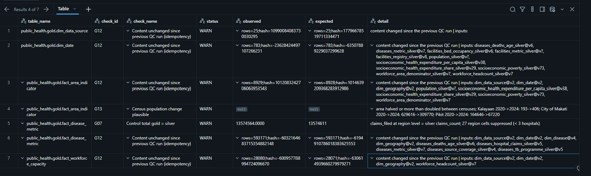

**I2: G12 per gold table.** Four tables already show PASS "same as previous": `dim_disease`, `dim_facility`, `dim_geography`, `fact_facility_capacity`. Their code and inputs did not change, and the rebuild gave identical content. `run_1` is null: only two earlier gold QC runs recorded G12. Some inputs show `@v?`: those silver tables are built by MERGE or Python and don't record a version in `build_inputs`.

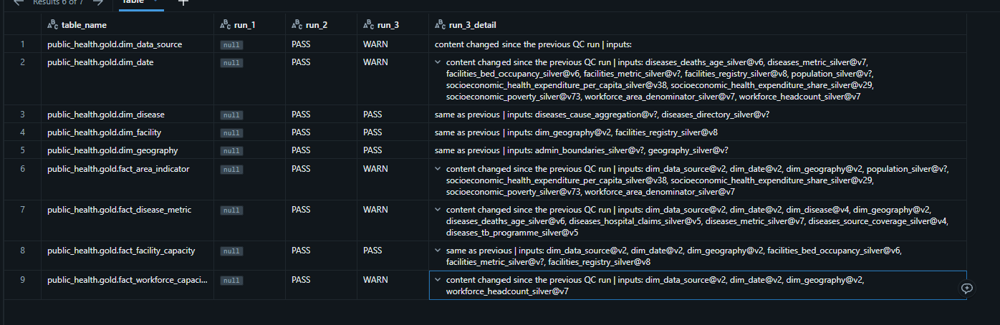

## 7. Row counts across builds (I1)

All 28 silver and gold tables have the same row count in their last three builds, except three. These three changed before this run, when workforce silver was rebuilt on 2026-10-20:

| Table | Earlier | This run |
|---|---|---|
| `silver.workforce_area_denominator_silver` | 3,023 | 3,024 |
| `gold.fact_workforce_capacity` | 28,071 | 28,080 |
| `gold.fact_area_indicator` | 8,928 | 8,929 |

Gold row counts match the 2026-10-18 run for every other table: `dim_geography` 1,764, `dim_facility` 3,957, `dim_disease` 179, `dim_date` 783, `dim_data_source` 25, `fact_facility_capacity` 30,365, `fact_disease_metric` 593,171, `ref_osm_healthsite_point` 16,030.

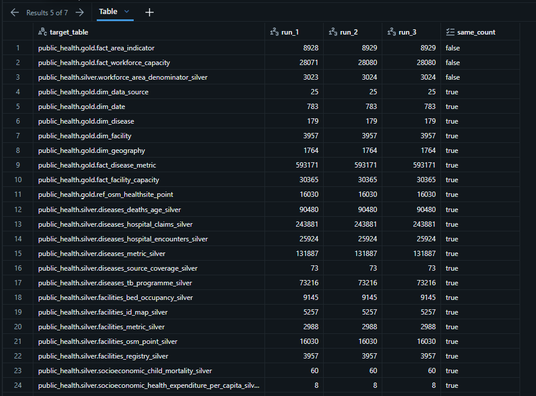
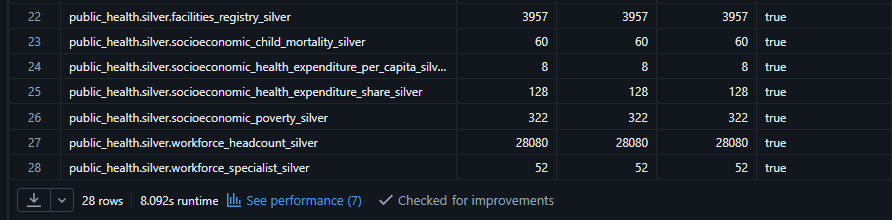

## 8. Open items

| Item | Action |
|---|---|
| Next run of the job, `26759964775689`, started 2026-10-21 10:16 Manila | Counts as run 2 if the conditions in [final runs](../README.md), section 2, hold |
| `qc_registry` task | Confirm it is in the job and green (scroll the task list to the end). The gate tasks are green (screenshot 9) |
| Code commit | Fill in section 1 |
| `facilities_metric_silver` null version | Backlog 7c |

## 9. What this run demonstrates

- The final job runs end to end in one run: bronze, gate, silver, silver QC, gold, gold QC.
- QC has 0 FAIL in every layer; every WARN is a known, expected WARN.
- Incremental bronze works: no file was reloaded, and every source still passed the gate on its latest QC result.
- Gold QC (118 checks, G00–G13) ran inside the job. On 2026-10-18 no gold QC existed.
- Four gold tables already rebuild to identical content (G12 PASS "same as previous").

## 10. What this run does NOT demonstrate

- Full idempotency. That needs runs 2 and 3: every G12 row PASS, the same row counts, and no bronze load.
- Restricted-table protection, reconciliation A–D, and dashboard freshness. Those are recorded separately.

## 11. History of updates

| Date | Change |
|---|---|
| 2026-10-21 | Record written from the run 1 job page and the seven evidence queries |
