# Final run 2 of 3: full pipeline job (2026-10-21)

Owner: LUNASaan Documentation Team
Last updated: 2026-10-21

This record documents run 2 of the [three final runs](../README.md) of 2026-10-21. Run 2 used the same job, code and inputs as [run 1](../run-1/run-1.md). It shows what a rerun on unchanged inputs does.

**Result:** the job succeeded, and every idempotency check passed:
- bronze loaded nothing;
- every silver and gold table has the same row count;
- all 9 gold tables have the same content as run 1 (G12 PASS "same as previous");
- QC found 0 FAIL in every layer, and only the 2 standing gold WARNs remain.

Recorded with the seven queries in [`evidence_queries.sql`](../../evidence_queries.sql), right after the run. Run 1 explains how to read each query and why the timestamps differ; this record lists only what is new. Times are UTC first, then Manila in brackets. Screenshots are in this folder, numbered as in the [evidence guide](../../README.md), section 4.

---

## 1. Run

| Item | Value |
|---|---|
| Job | `[dev jemmalyn_santiago] ph-public-health-pipeline`, job id `587047839768584` (same as run 1) |
| Run id | `26759964775689` |
| Trigger | Manual |
| Started | 2026-10-21 02:16 UTC (10:16 Manila) |
| Ended | 2026-10-21 03:16 UTC (11:16 Manila) |
| Duration | 59m 45s |
| Result | Succeeded: every task green, including `setup` and the six `gate_<domain>` tasks |
| Code | Same commit as run 1: no merge or bundle deploy between the runs |

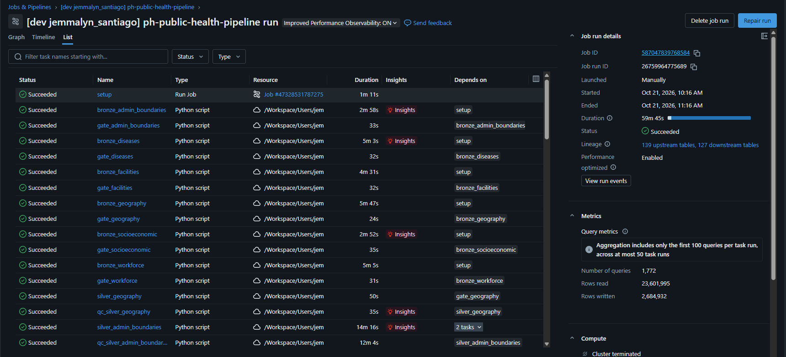

## 2. Timeline from the quality tables

| Step | Time (UTC) | Manila | Source |
|---|---|---|---|
| Bronze loaders: every file skipped | 02:18 – 02:22 | 10:18 – 10:22 | I3 |
| Silver builds | 02:22 – 02:56 | 10:22 – 10:56 | S2 |
| Silver QC, all scripts | 02:25 – 03:00 | 10:25 – 11:00 | S1 |
| Gold builds | 03:03 – 03:05 | 11:03 – 11:05 | S2 |
| Gold QC | 03:10 | 11:10 | S1 |

Run 2 is about 11 minutes shorter than run 1. Both runs loaded nothing in bronze, so the difference is in the silver and gold task times.

## 3. Results

| Query | Result | Pass? |
|---|---|---|
| B1 | The same 3 expected bronze WARNs, with the same `last_checked_at` as run 1 (2026-10-17 to 10-19): no bronze QC re-ran because nothing reloaded | Yes |
| S1 | 0 FAIL in every script. Silver and gold QC are dated this run; bronze QC dates are unchanged | Yes |
| S2 | All 28 silver and gold tables `succeeded`, finished during this run. Delta versions went up by one per rebuild (for example `dim_date` v2 → v3) | Yes |
| G1 | 0 FAIL, 2 WARN: G13 (census boundary changes) and G07 (27 claims cells suppressed). **No G12 row** | Yes |
| I1 | `same_count` true for all 28 tables | Yes |
| I2 | `run_3` (this run) PASS "same as previous" for all 9 gold tables | Yes |
| I3 | "loaded 0, failed 0" for all 40 sources in all three columns; `no_reload` true | Yes |

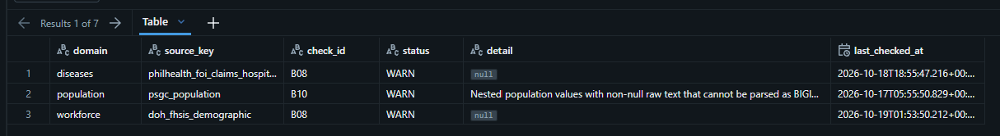
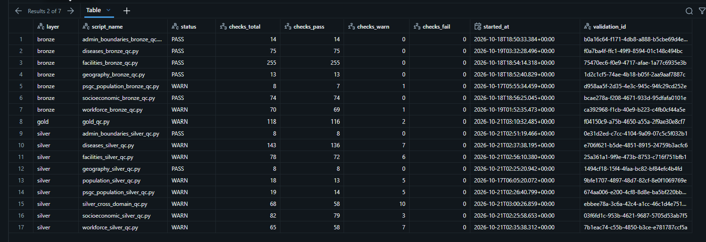
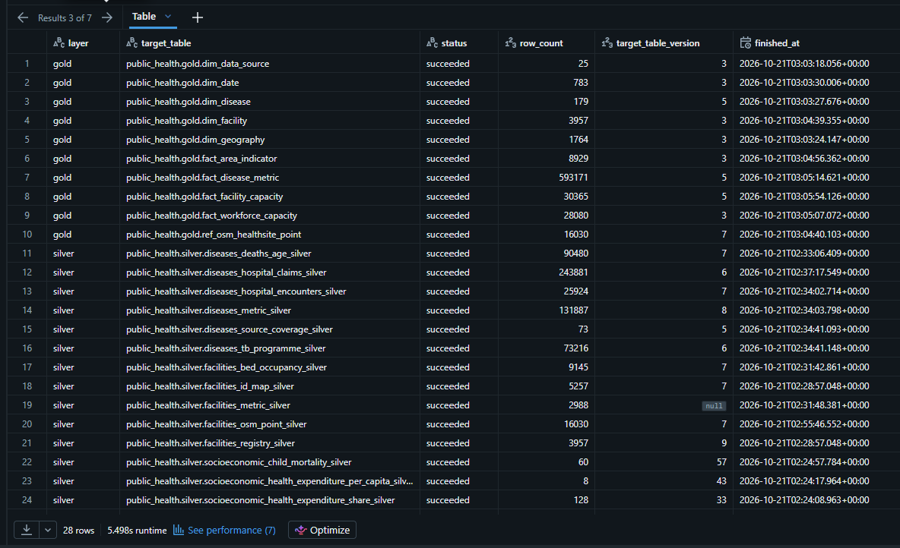
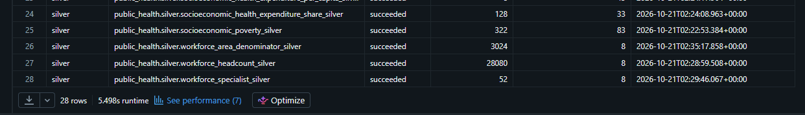
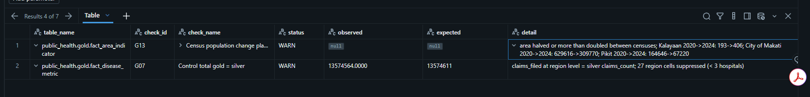

### What changed from run 1

| Item | Run 1 | Run 2 | Why |
|---|---|---|---|
| Gold QC | 118 checks: 111 PASS, 7 WARN | 118 checks: 116 PASS, 2 WARN | The 5 G12 WARNs of run 1 compared it with the run before the gold pass. Run 2 compares with run 1: same content, so PASS |
| G12 detail | "content changed since the previous QC run" | "same as previous" on all 9 tables | The rebuild gave identical content |
| G13, G07 | WARN | WARN | Standing WARNs: real census boundary changes, and claims suppression (D-47). They stay WARN on every run |
| Input versions in G12 detail | for example `diseases_metric_silver@v7` | `@v8` | Silver rebuilt, so its Delta version went up by one. The content is the same, which is exactly what G12 checks |

**How to read I2 now:** the three columns are the last three gold QC runs: the run before the gold pass, run 1 and run 2. The pattern PASS → WARN → PASS is the expected one. Run 1 picked up the gold-pass changes once; run 2 then matched run 1 exactly.

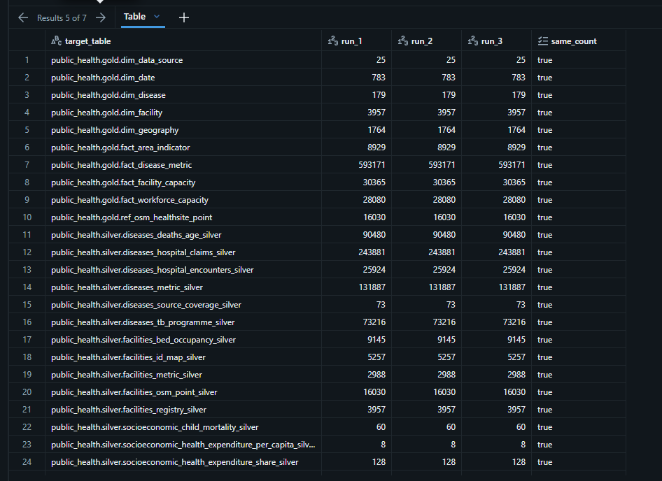
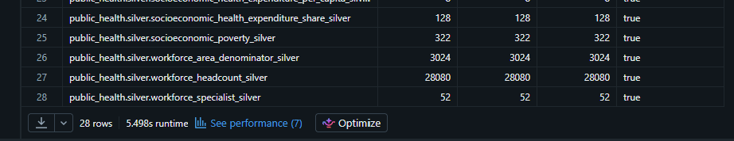
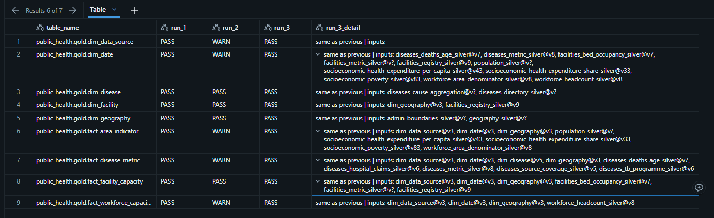
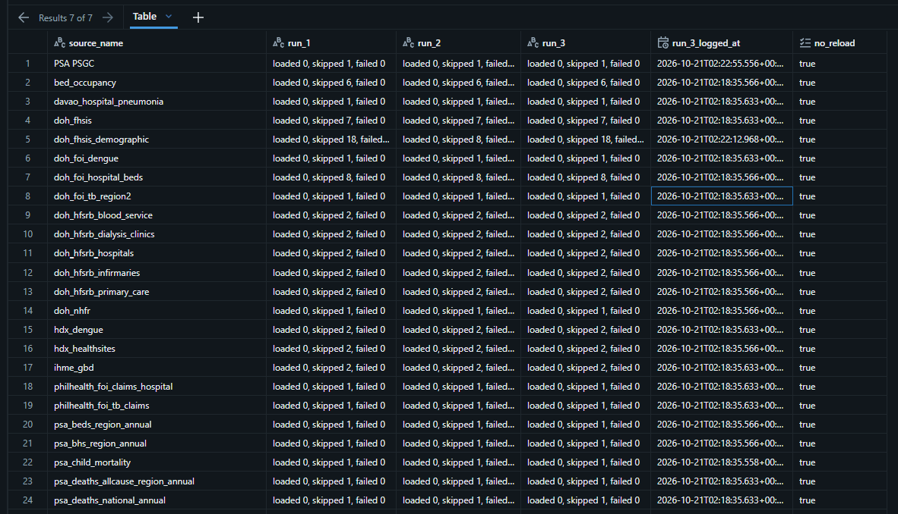
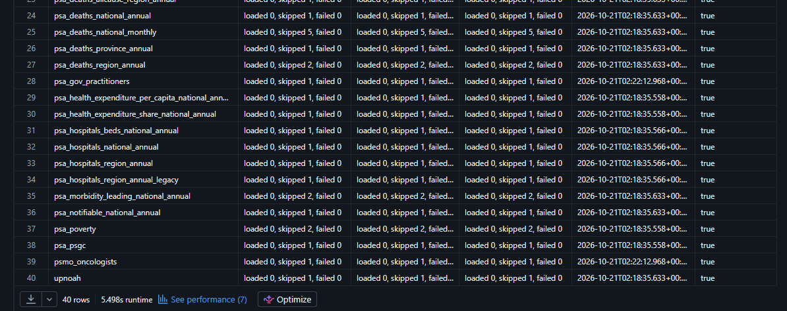

## 4. Notes

- `facilities_metric_silver` still logs a null `target_table_version` (backlog 7c). Its row count is the same (2,988).
- `doh_fhsis_demographic` logs 18, 8 and 18 skipped sheets across the I3 columns. Nothing loaded or failed in any of them.
- `population_silver_qc.py` (2026-10-17) is the old script name; ignore that row.

## 5. History of updates

| Date | Change |
|---|---|
| 2026-10-21 | Record written from the run 2 job page and the seven evidence queries |
