# Final run 3 of 3: full pipeline job (2026-10-21)

Owner: LUNASaan Documentation Team
Last updated: 2026-10-21

This record documents run 3 of the [three final runs](../README.md) of 2026-10-21. It ran the same job, code and inputs as [run 2](../run-2/run-2.md) and confirms it.

**Result:** the job succeeded and every idempotency check passed again:
- bronze loaded nothing;
- all 28 silver and gold tables have the same row count in runs 1, 2 and 3;
- all 9 gold tables have the same content as run 2 (G12 PASS "same as previous");
- QC found 0 FAIL in every layer; only the 2 standing gold WARNs remain;
- `qc_registry` passed.

Recorded with the seven queries in [`evidence_queries.sql`](../../evidence_queries.sql), right after the run. [Run 1](../run-1/run-1.md) explains how to read each query and why the timestamps differ. Times are UTC first, then Manila in brackets. Screenshots are in this folder, numbered as in the [evidence guide](../../README.md), section 4.

---

## 1. Run

| Item | Value |
|---|---|
| Job | `[dev jemmalyn_santiago] ph-public-health-pipeline`, job id `587047839768584` (same as runs 1 and 2) |
| Run id | `996544156339205` |
| Trigger | Manual |
| Started | 2026-10-21 03:28 UTC (11:28 Manila) |
| Ended | 2026-10-21 04:32 UTC (12:32 Manila) |
| Duration | 1h 4m 9s |
| Result | Succeeded: every task green, including `setup`, the six `gate_<domain>` tasks and `qc_registry` |
| Code | Same commit as run 2 |

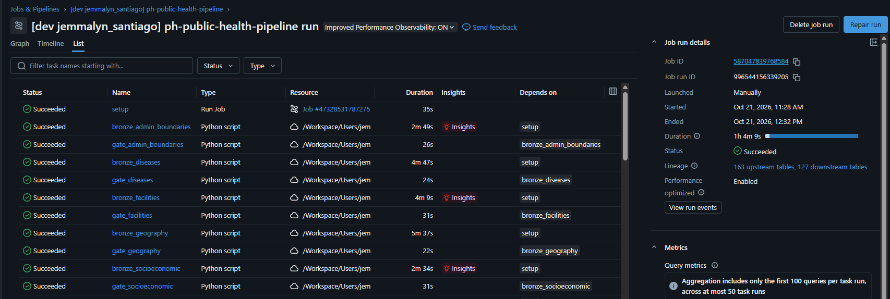

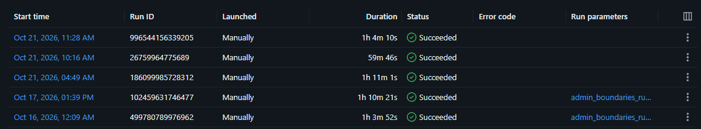

## 2. Timeline from the quality tables

| Step | Time (UTC) | Manila | Source |
|---|---|---|---|
| Bronze loaders: every file skipped | 03:29 – 03:33 | 11:29 – 11:33 | I3 |
| Silver builds | 03:32 – 04:10 | 11:32 – 12:10 | S2 |
| Silver QC, all scripts | 03:35 – 04:15 | 11:35 – 12:15 | S1 |
| Gold builds | 04:18 – 04:21 | 12:18 – 12:21 | S2 |
| Gold QC | 04:25 | 12:25 | S1 |

## 3. Results

| Query | Result | Pass? |
|---|---|---|
| B1 | The same 3 expected bronze WARNs with the same `last_checked_at` as runs 1 and 2: no bronze QC re-ran because nothing reloaded | Yes |
| S1 | 0 FAIL in every script. Gold QC `64d2024a-98e1-4033-8b64-3efec820c709`: 118 checks, 116 PASS, 2 WARN | Yes |
| S2 | All 28 silver and gold tables `succeeded` during this run; Delta versions up by one per rebuild | Yes |
| G1 | 0 FAIL, 2 WARN: G13 (census boundary changes) and G07 (27 claims cells suppressed). No G12 row | Yes |
| I1 | `same_count` true for all 28 tables; the three columns are final runs 1, 2 and 3 | Yes |
| I2 | WARN → PASS → PASS for 5 tables and PASS → PASS → PASS for 4; `run_3` PASS "same as previous" on all 9 | Yes |
| I3 | "loaded 0, failed 0" for all 40 sources in all three columns; `no_reload` true | Yes |

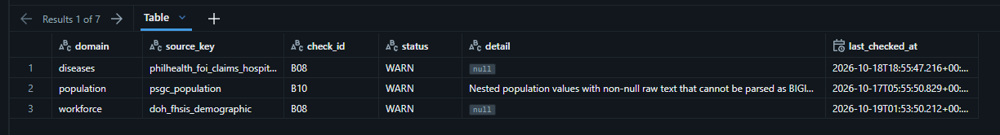
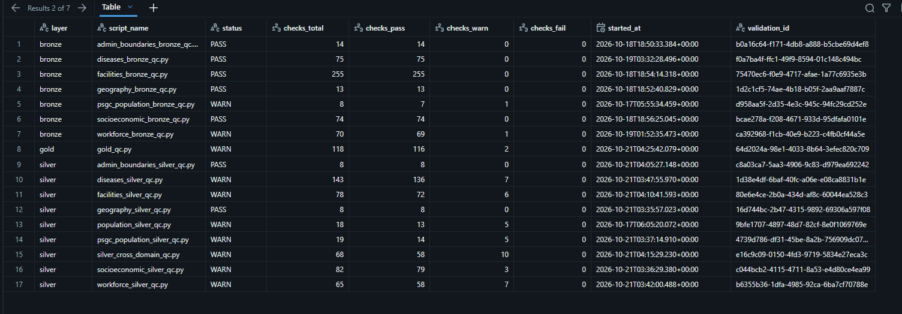
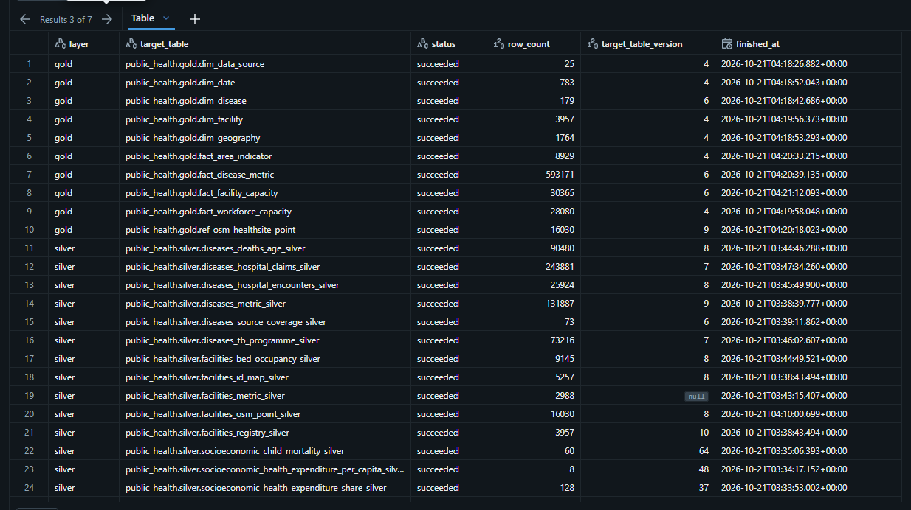
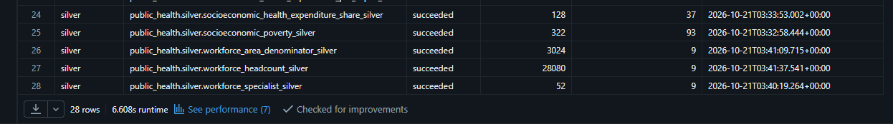
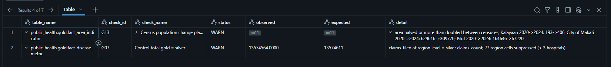
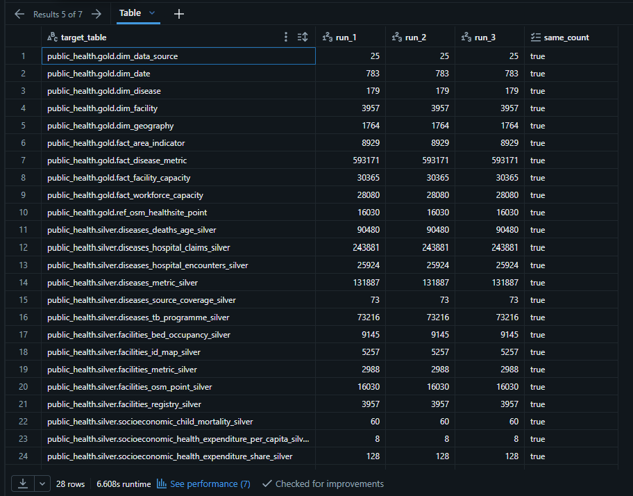
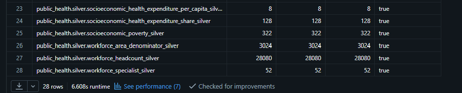
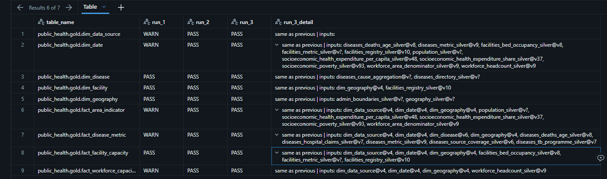
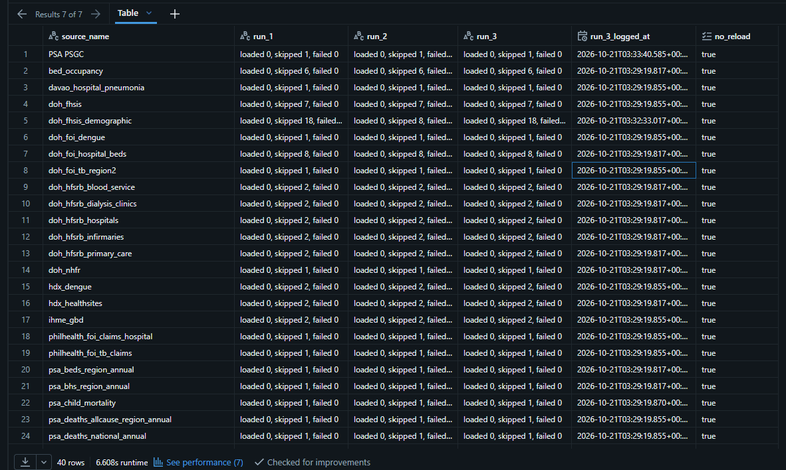
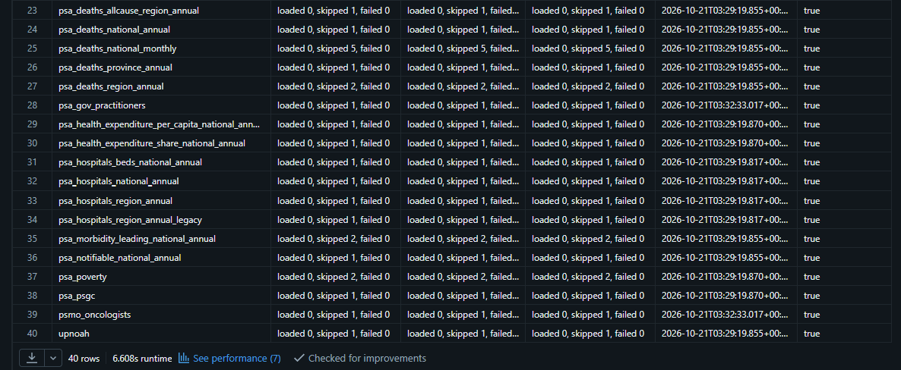

**How to read I2 now:** the three columns are final runs 1, 2 and 3. Run 1 picked up the gold-pass changes once (WARN on 5 tables); runs 2 and 3 match exactly. That is the idempotency claim: the same inputs and code give the same published content.

## 4. Notes

- `facilities_metric_silver` still logs a null `target_table_version` (backlog 7c). Its row count is the same (2,988).
- `doh_fhsis_demographic` logs 18, 8 and 18 skipped sheets across the I3 columns. Nothing loaded or failed.
- `population_silver_qc.py` (2026-10-17) is the old script name; ignore that row.
- Strict registry (`strict_registry=True`) was switched on after this run and merged into `dev` on 2026-10-21. The first strict run is the next job run.

## 5. History of updates

| Date | Change |
|---|---|
| 2026-10-21 | Record written from the run 3 job page and the seven evidence queries |
